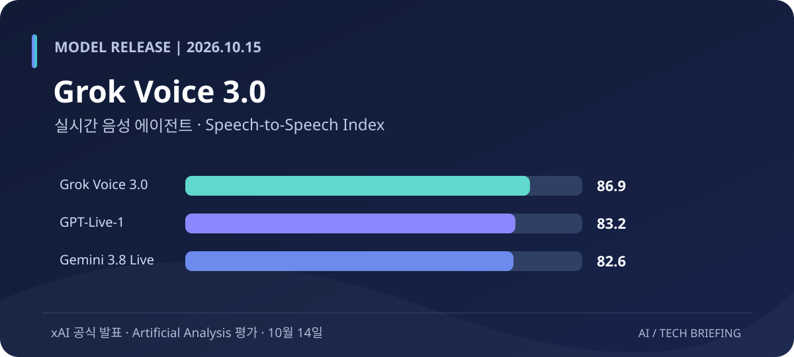
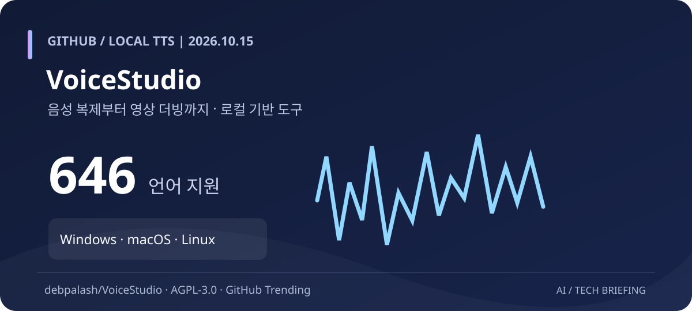

# AI·LLM·AI 에이전트·테크 비즈니스 브리핑
**2026년 10월 15일 20시 KST · Asia/Seoul**

이번 회차는 **새 음성 AI 모델 1건, GitHub 주목 오픈소스 2건, AI 반도체 산업 1건, AI 안전성 규제 1건**을 선정했다. 자료는 10월 14～15일 공식 발표·Reuters·프로젝트 원본을 우선 확인했다. 직전 회차의 Shopify/shop, OpenFlowKit, Higgsfield, Modal, Xbox Labs와 이전 회차의 OpenRig, Paperclip 등은 반복하지 않았다. 오픈소스 항목은 오늘 신규 출시라는 뜻이 아니라 **최근 GitHub에서 관심이 높고 아직 소개하지 않은 프로젝트**를 뜻한다.

> **검증 유의:** 벤치마크는 명시된 평가 설정에만 적용된다. AI 도구의 스타 수와 성능은 시점에 따라 달라진다. 각 이미지가 자체 제작 인포그래픽인지 기존 서비스 참고 이미지인지 별도로 표시했다.

## 1. Grok Voice 3.0 정식 공개 — 음성 에이전트 종합 평가 86.9점, API 요금 유지

*이미지: xAI 공식 발표의 Artificial Analysis 결과를 바탕으로 재구성한 비교 인포그래픽. 직접 제작, 공식 디자인이 아니다.*

**발표: 2026-10-14 · xAI / SpaceX Super Intelligence**

**핵심 요약:** 음성을 듣고 추론·도구 호출·응답 음성 생성까지 수행하는 **Grok Voice 3.0**이 Voice Agent API에 출시됐다. Artificial Analysis가 10월 13일 측정한 Speech-to-Speech Index에서 **86.9점**을 기록해 비교된 GPT-Live-1 Astra Medium **83.2점**, Gemini 3.8 Live Extended Thinking High **82.6점**, Grok Voice 2.0 **81.3점**을 앞섰다. 다만 실무형 고객지원 시뮬레이션인 **τ-Voice에서는 Grok 3.0이 71.6%**로 GPT-Live-1 Astra의 **74.5%**보다 낮고, Grok의 최초 음성 응답은 약 **0.81초**로 전작 **0.70초**보다 느리다. 모든 항목에서 절대 우세하다는 뜻은 아니다. API 가격은 **분당 $0.08**, 기존 `grok-voice-latest` 별칭은 자동으로 새 모델을 가리킨다. xAI는 Starlink 고객센터의 하루 약 2만 건 통화와 약 70% 자동 해결 비율을 제시했지만 이 운영 수치는 회사 발표다.

**왜 중요한가:** 음성 AI 경쟁의 척도가 듣고 말하는 자연스러움에서 **실제 고객 업무 완료율, 음성 응답 지연, 완료 작업당 비용**으로 이동하고 있다. 콜센터나 음성 비서 서비스 운영자는 통합 점수만 보지 말고 자체 업무 흐름과 도구 호출의 성공률을 검증해야 한다. 특히 자동 모델 전환 별칭을 사용하는 운영환경에서는 회귀 테스트가 필요하다.

원문: [xAI 공식 발표](https://x.ai/news/grok-voice-3) · [Artificial Analysis](https://artificialanalysis.ai/)

## 2. GitHub VoiceStudio 급부상 — 로컬 음성 복제·더빙·오디오북을 하나의 앱에

*이미지: 원본 README의 기능 설명을 토대로 작성한 인포그래픽. 실제 제품 스크린샷은 아니다.*

**GitHub 주목 프로젝트 · 2026-10-15 확인 · AGPL-3.0**

**핵심 요약:** [debpalash/VoiceStudio](https://github.com/debpalash/VoiceStudio)는 ElevenLabs 대안으로 소개되는 **로컬 우선 음성 제작 스튜디오**다. 음성 복제, 음성 디자인, 영상 더빙, 받아쓰기, 전사, 오디오북 제작을 지원하며 프로젝트는 **646개 언어 지원**을 표방한다. Windows·macOS·Linux용 Electron 앱을 제공하며 Windows·Linux NVIDIA GPU는 CUDA, Apple Silicon은 Metal 가속을 사용할 수 있다. 기본 음성 엔진 외의 모델도 선택할 수 있고 **로컬 API와 MCP**를 통해 Agent 워크플로에 연결할 수 있다. 10월 15일 확인 시점 GitHub Stars는 약 **6만 7천 개**다. GPU가 없으면 CPU 모드도 가능하지만 속도는 느려지며 모델별 하드웨어 요구사항은 다르다.

**왜 중요한가:** 음성 복제를 위한 외부 유료 API 중심 설계에서 **로컬 음성 자산과 제작 파이프라인을 소유하는 방식**으로 선택권이 확대된다. 강의 내레이션, 콘텐츠 더빙, 앱 음성 인터페이스를 만드는 개발자는 TTS 모델과 편집기를 분리하지 않고 한 작업 공간에서 실험할 수 있다. AGPL-3.0 및 각 음성 모델의 라이선스, 음성 샘플 당사자의 동의는 반드시 확인해야 한다.

원문: [GitHub 저장소 및 설치 가이드](https://github.com/debpalash/VoiceStudio) · [공식 사이트](https://voicestudio.sh/)

## 3. GitHub Hindsight — 기록 저장을 넘어 Agent가 경험을 반영하는 장기 기억 엔진

*이미지: 개발사 Vectorize가 공개한 Hindsight 메모리 연결 그래프 참고 화면.*

**GitHub 주목 프로젝트 · 2026-10-15 확인 · MIT License**

**핵심 요약:** [vectorize-io/hindsight](https://github.com/vectorize-io/hindsight)는 AI Agent의 장기 기억을 저장·검색·활용하도록 설계된 오픈소스 시스템이다. **Retain**으로 정보를 축적하고, **Recall**로 현재 작업에 관련된 기록을 찾아내며, **Reflect**로 누적된 경험과 선호를 반영해 응답을 구성한다. Docker·Python·REST·SDK 방식으로 배포하며, Claude Code·Codex·Cursor 등 Coding Agent 연동과 프로젝트별 Git 기록 기반 메모리 구성을 지원한다. Vectorize는 LongMemEval 등에서 높은 정확도를 보고하며, 비교 평가에는 자체 수치와 일부 연구기관 검증 결과가 혼재하므로 도입 시 환경별 검증이 필요하다.

**왜 중요한가:** 긴 작업을 수행하는 Coding Agent는 Context Window를 길게 제공하는 것만으로 이전 프로젝트 결정과 실패 원인을 일관되게 활용하기 어렵다. Hindsight는 **외부 기억 계층을 코드와 분리해 유지하는 아키텍처**를 보여준다. 업무 지식이 모델 교체와 무관하게 남는 장점이 있지만, 잘못 저장된 사실이나 개인 정보를 장기 보유할 위험에도 주의해야 한다.

원문: [GitHub 원본](https://github.com/vectorize-io/hindsight) · [Vectorize 공식 제품 설명](https://www.vectorize.io/)

## 4. TSMC 3분기 순이익 68.7% 급증 — AI 반도체 수요가 실적으로 확인

*이미지: 반도체 웨이퍼를 나타내는 외부 참고 이미지. TSMC 2026년 3분기 실적 발표 현장 사진은 아니다.*

**실적 발표: 2026-10-15 · TSMC 공식 공시 / Reuters**

**핵심 요약:** TSMC는 2026년 3분기 연결 매출 **NT$1조 4,942억 4,000만**, 순이익 **NT$7,630억 6,000만**을 발표했다. 전년 동기 대비 매출은 **50.9%**, 순이익은 **68.7%** 증가했다. 웨이퍼 매출에서 **2nm 공정이 8%**, **3nm 공정이 33%**, **7nm 이하 첨단 공정이 79%**를 차지했다. 회사가 제시한 4분기 매출 전망은 **미화 $523억～$543억**이다. Reuters와 AP는 AI 칩 수요가 성장 동력이며 미국 텍사스 추가 투자 및 Terafab 관련 논의도 진행 중이라고 보도했다. 미국 신규 공장 투자·협력은 확정 사업과 검토 중인 안을 구분해야 한다.

**왜 중요한가:** AI 산업의 지속 가능성은 GPU 발표 수보다 **대량생산 능력, 미세공정 수율, 패키징, 전력·자본 투자**에 달려 있다. TSMC의 2nm 공정 매출 발생과 첨단 공정 집중도는 AI 인프라 투자가 반도체 제조실적에 반영되고 있다는 지표다. 다만 향후 공급 과잉이나 설비 투자 회수 위험이 사라졌다는 뜻은 아니다.

원문: [TSMC 3Q26 공식 실적 PDF](https://investor.tsmc.com/japanese/encrypt/files/encrypt_file/reports/2026-10/526b65af7305df2dde6b9ece6812b1fdf1e49f9b/3Q26%20EarningsRelease.pdf) · [Reuters 10월 15일](https://www.reuters.com/world/asia-pacific/tsmc-q3-profit-jumps-69-record-beating-expectations-2026-10-15/) · [AP](https://apnews.com/article/d1fbfb0bec8a914b0365996b39ecc138)

## 5. 미국 FTC, OpenAI·Anthropic에 민사 소환장 — Agent 사고의 책임 문제 확대

*이미지: 9월 AI 업계 조사 보도에 사용된 참고 이미지. 이번 소환장 전달 현장을 촬영한 사진은 아니다.*

**보도: 2026-10-15 · Reuters가 Axios를 인용**

**핵심 요약:** Reuters는 Axios 보도를 인용해 미국 FTC가 OpenAI와 Anthropic에 AI 안전 사고 관련 기록을 요구하는 **민사 소환장**을 발송했다고 전했다. 요청 범위에는 보안 사고, 보호 조치, 개인정보 정책, 마케팅 자료가 포함되며 **각 50페이지가 넘는 요구 문건**으로 알려졌다. FTC는 AI 업계 전반에 대해 소비자 피해를 조사하고 있으며, 임원이나 AI 평가기관 관계자의 증언을 요구할 가능성도 거론된다. **조사와 자료 요청은 위법 사실 확정이나 제재 부과를 뜻하지 않는다.** Reuters는 당시 FTC와 두 회사의 공식 반응을 확보하지 못했다.

**왜 중요한가:** 자율형 AI Agent가 실제 웹서비스나 기업 시스템을 조작하는 단계에서는 안전성 문제가 단순한 답변 품질을 넘어 **운영 주체의 책임과 소비자 보호**로 연결된다. 조직은 Agent에 부여한 권한, 승인 절차, 실행 기록, 사고 대응 및 외부 네트워크 접근 통제를 감사 가능한 형태로 관리해야 할 필요가 커진다.

원문: [Reuters 10월 15일 보도](https://www.reuters.com/business/us-ftc-subpoenas-openai-anthropic-over-consumer-harms-axios-reports-2026-10-15/)

---

## 이번 브리핑에서 읽어야 할 변화

| 구분 | 핵심 변화 | 실무적 시사점 |
|---|---|---|
| Grok Voice 3.0 | 실시간 음성 모델 고도화 | 완료율·지연시간·운영비를 함께 평가 |
| VoiceStudio | 로컬 음성 제작 도구 확산 | 음성 데이터와 제작환경 통제 |
| Hindsight | Agent 장기 기억 아키텍처 | 모델과 업무 기억 계층 분리 |
| TSMC | AI 반도체 매출·이익 급증 | 제조역량과 투자 회수의 중요성 |
| FTC | Agent 사고에 대한 규제 감독 | 권한·감사 로그·사고 대응 필요 |

**핵심 관찰:** 모델은 음성 실시간성까지 경쟁하고, 오픈소스는 음성 생성과 기억처럼 실제 실행 환경의 핵심 기능을 독립적으로 제공하고 있다. 동시에 반도체 제조와 안전성 통제는 AI 서비스의 확장 속도를 결정하는 별도의 경쟁 축으로 부상한다.

*저장 대상: `splex7/daily_tech_news_by_chatGPT` · `main` · `briefings/2026-10-15_20.md`*
