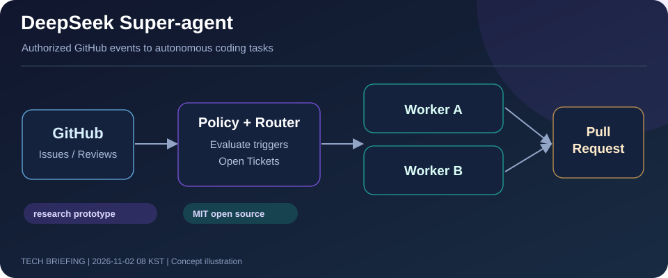
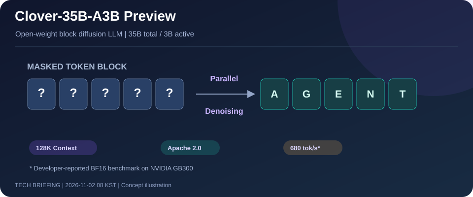
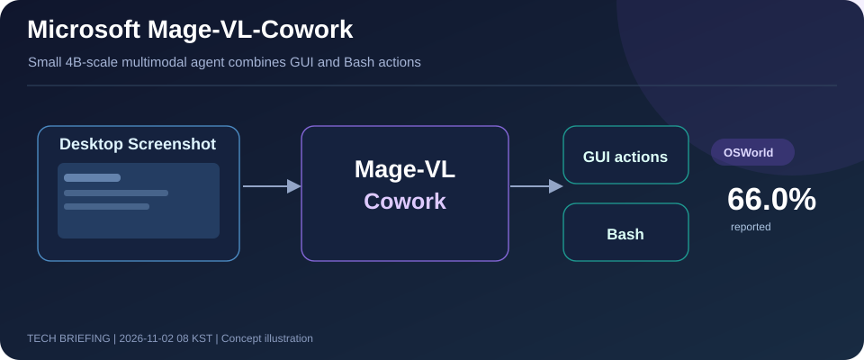
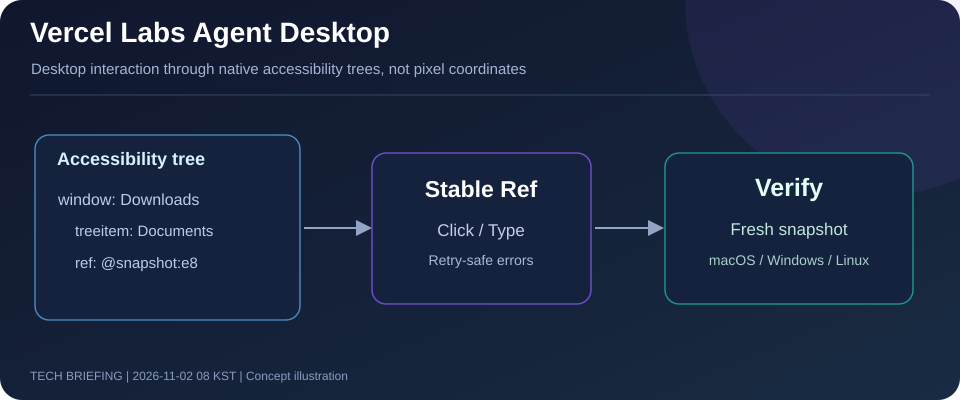
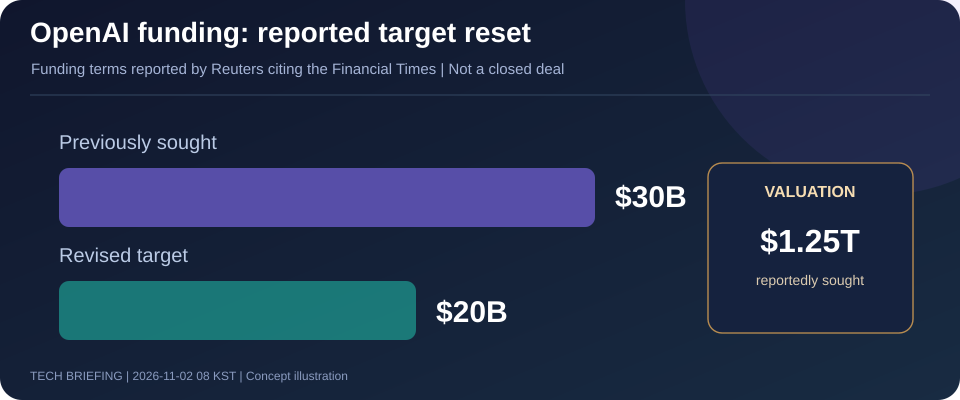

# AI·LLM·AI 에이전트·테크 비즈니스 3일 브리핑

**발행:** 2026-11-02 08 KST  
**조사 기간:** 2026-10-30 08:00～2026-11-02 08:00 KST  
**선정:** 오픈소스 AI Agent 2건, 신규 오픈웨이트 모델 2건, 테크 비즈니스 1건  
**중복 제외:** 직전 회차의 Mistral Large 4, Gemini 4 Carbon, GitHub Copilot Fusion, GitHub Agentic Workflows, Akamai Agent Sandbox는 재수록하지 않았다. 기존에 언급된 OpenAI 투자 협상은 목표 규모가 실질적으로 변경됐다는 점에서 후속 소식으로 다뤘다.

> **한 줄 결론:** AI Agent가 개발팀에 상주하는 방향으로 발전하고, 비교적 작은 오픈 모델도 화면 조작과 빠른 생성에서 경쟁력을 높이고 있다. 모델 성능과 함께 권한·실행환경·검증 절차를 설계해야 한다.

---

## 1. DeepSeek, Super-agent 연구용 오픈소스 공개 — GitHub 상주형 코딩 Agent



*이미지: 공식 저장소의 구조를 재구성한 편집용 개념도 · 10월 31일 공개 · MIT 라이선스*

### 핵심 요약
DeepSeek Harness 팀이 `dsh-superagent-prototype`을 GitHub에 공개했다. **한 개의 저장소**와 연결되어 허용된 GitHub 이벤트 또는 요청을 확인하고, Router가 이를 Ticket으로 전환한 뒤 별도 Worker 세션에서 코딩 작업을 수행한다. 결과는 코멘트나 Pull Request 형태로 돌아오며, 사람의 결정을 기다리는 작업은 관리 패널에서 확인할 수 있다.

핵심 설계 원칙은 **사람의 주의를 최소한으로 소비하는 것**이다. 다만 무단으로 모든 일을 시작하는 시스템은 아니다. 팀에서 허가한 요청이나 작성한 규칙만 처리하며, 선제 작업은 기본 관찰 모드로 시작하고 자동 병합 역시 기본적으로 비활성화되어 있다.

**주의:** README는 이 코드를 공식 완제품이 아닌 *연구용 참고 프로토타입*으로 명시한다. 별도 OS 사용자 계정 격리가 권장되며, 실사용 안전성을 입증하는 벤치마크는 없다.

### 왜 중요한가?
AI Coding Agent가 '내가 부를 때 실행하는 도구'에서 '이벤트를 감지하며 지속적으로 운영하는 개발팀 구성원'으로 진화하는 흐름을 보여준다. **업무 큐, 권한, 지속 상태, 독립 실행, 승인, 감사 가능성**을 아키텍처에 포함해야 한다.

**출처:** [공식 GitHub](https://github.com/deepseek-ai/dsh-superagent-prototype) · [설계 원칙](https://github.com/deepseek-ai/dsh-superagent-prototype/blob/main/docs/000-philosophy.md) · [배포·권한 주의사항](https://github.com/deepseek-ai/dsh-superagent-prototype/blob/main/docs/006-deployment.md) · [10월 31일 최초 커밋](https://github.com/deepseek-ai/dsh-superagent-prototype/commits)

---

## 2. DiffuSpace, Clover-35B-A3B 공개 — 고속 확산형 LLM과 로컬 구동 실험



*이미지: 공식 발표의 디코딩 개념을 재구성한 설명도 · 10월 30일 공개 · Apache 2.0*

### 핵심 요약
`Clover-35B-A3B-Preview`는 약 **350억 전체 파라미터·30억 활성 파라미터**의 MoE 기반 **Block Diffusion 언어모델**이다. 컨텍스트 길이는 128K이며 모델 가중치와 추론 코드를 공개했다.

| 개발사 발표 지표 | 수치 |
|---|---:|
| SWE-bench Verified | **73.6%** |
| Terminal-Bench 2.1 | **51.7%** |
| 단일 NVIDIA GB300, BF16, batch 1 | **680 tokens/s** |
| 단일 RTX 5070 Ti 16GB, INT4, MATH-500 조건 | **101.8 tokens/s** |

숫자는 **개발사 측정**이며 동일한 하드웨어·추론 설정에서 독립 비교한 것이 아니다. 개발사는 SGLang과 llama.cpp 연동을 설명하며 공식 GGUF 양자화도 제공한다. 다만 공개된 공식 GGUF 중 가장 작은 Q4_0 파일도 **18.24GiB**이고, 일반 릴리스의 llama.cpp와 완전 호환된다고 단정할 수 없다. 따라서 '16GB GPU에서 즉시 로드 가능'이라는 뜻은 아니다.

### 왜 중요한가?
기존의 토큰 순차 생성과 달리 **블록 내 병렬 생성**을 활용하면 Agent가 여러 추론 단계를 반복할 때 대기시간을 줄일 가능성이 있다. MoE·양자화·디코딩 엔진·추론 하드웨어를 함께 설계해야 한다는 사례다. 특히 16GB VRAM 개발자는 실제 사용 메모리와 구현 요구사항을 별도로 확인할 가치가 있다.

**출처:** [DiffuSpace 공식 발표](https://huggingface.co/blog/Diffuspace/clover-35b-a3b-preview) · [모델 카드](https://huggingface.co/Diffuspace/Clover-35B-A3B-Preview) · [공식 GGUF](https://huggingface.co/Diffuspace/Clover-35B-A3B-Preview-GGUF) · [GitHub](https://github.com/DiffuSpace/Clover-35B-A3B-Preview)

---

## 3. Microsoft, Mage-VL-Cowork 공개 — 4B급 소형 모델이 GUI와 터미널을 함께 조작



*이미지: Microsoft 공개 모델 카드 기반 개념도 · 10월 30일경 공개 · Apache 2.0*

### 핵심 요약
Microsoft가 공개한 `Mage-VL-Cowork`는 약 **4B급의 소형 비전·언어 기반 Computer Use Agent**다. 데스크톱 화면을 읽는 시각 처리와 **마우스·키보드 GUI 동작, Bash 명령 실행**을 하나의 모델·실행 루프로 통합한다.

Microsoft의 모델 카드에 따르면 **OSWorld-Verified에서 66.04%**를 기록했다. Google Drive 과제를 제외한 **361개 과제**, 최대 **50단계**, **독립된 두 번의 전체 평가 평균**이다. GUI 기반 학습 단계에서 이후 하이브리드 강화학습 단계로 진행하면서 작업당 출력 토큰은 6,401에서 5,499로 줄고 성공률은 45.56%에서 66.04%로 개선됐다고 보고했다.

**주의:** 개발사 자체 설정에서의 평가 결과이며, 모든 실제 PC 작업에서 66% 성공을 보장하지 않는다. 모델 카드에서는 임의의 셸 명령과 GUI 동작을 실행하므로 **일회용 VM·컨테이너 안에서 격리**하고 개인 키·토큰을 노출하지 말라고 권고한다. 모델 가중치만 약 9.5GB 수준이므로 GPU 메모리 외 추론 오버헤드도 고려해야 한다.

### 왜 중요한가?
화면을 보는 Agent와 셸을 실행하는 Agent를 분리하지 않고 **하나의 소형 모델이 두 인터페이스를 선택**할 수 있게 됐다. 로컬 Computer Use 가능성을 높이는 동시에, 파일·네트워크·인증 접근을 제어하는 실행 샌드박스의 중요성이 커진다.

**출처:** [Microsoft 공식 Hugging Face 모델 카드](https://huggingface.co/microsoft/Mage-VL-Cowork)

---

## 4. Vercel Labs의 agent-desktop 주목 — 픽셀 좌표 대신 접근성 트리로 데스크톱 제어



*이미지: 공식 README 기반 개념도 · 10월 말～11월 초 GitHub 주목 프로젝트 · Apache 2.0*

### 핵심 요약
Vercel Labs의 `agent-desktop`은 **AI 모델 자체가 아니라** AI Agent에게 운영체제의 데스크톱 제어 능력을 제공하는 **Rust 기반 CLI·C 라이브러리**다.

화면에서 클릭 좌표를 추측하는 대신 macOS·Windows·Linux의 **접근성 트리**를 구조화된 JSON으로 읽고, 각 요소에 할당된 참조 ID를 통해 클릭·입력·선택 동작을 수행한다. 실행 뒤 다시 스냅샷을 읽어 성공 여부를 검증할 수 있다.

```bash
npm install -g agent-desktop
agent-desktop snapshot --app Finder -i
# 스냅샷이 반환한 실제 ref로 조작
agent-desktop click '@s8f3k2p9:e8'
```

위 참조 ID는 공식 문서의 *예제*이며 실제 실행 시 생성되는 값으로 교체해야 한다. 접근성 정보를 제공하지 않는 UI는 이 방법으로 조작하기 어렵고, 스냅샷·클립보드에는 민감한 정보가 포함될 수 있다.

### 왜 중요한가?
Computer Use의 실행 품질은 **LLM의 추론능력뿐 아니라 도구 인터페이스의 안정성**에 크게 좌우된다. 접근성 트리·참조 ID·오류 복구 규약은 GUI 자동화를 더 결정적이고 검증 가능한 작업에 가깝게 만드는 접근법이다.

**출처:** [Vercel Labs 공식 GitHub](https://github.com/vercel-labs/agent-desktop) · [접근성 기반 아키텍처 FAQ](https://github.com/vercel-labs/agent-desktop/blob/main/docs/faq.md) · [최근 오픈소스 관심 동향](https://earlysignal.news/week)

---

## 5. OpenAI 투자 유치 목표 300억 달러에서 200억 달러로 하향 보도 — AI 투자 부담 현실화



*이미지: Reuters·Financial Times 보도 수치로 작성한 비교 개념도 · 10월 30일 미국 현지 보도 / 10월 31일 UTC*

### 핵심 요약
Reuters는 Financial Times의 관계자 취재를 인용해 OpenAI가 이번 투자 유치의 목표를 **300억 달러에서 약 200억 달러**로 낮췄다고 보도했다. 희망 기업가치도 **1조 4,000억 달러에서 1조 2,500억 달러**로 내려간 것으로 전해졌다.

이는 **확정된 투자금이나 완료된 거래가 아닌 협상 중인 조건**이다. 일부 투자자의 투자 약정 축소, AI 인프라 지출에 대한 우려와 미국 기술주 조정이 배경으로 거론됐다. 같은 날 나온 Reuters 보도에는 이전 평가액을 14억 달러로 적은 내부 표기 오류가 있으므로, 앞선 Reuters 보도 및 후속 보도와 대조하여 **1조 4,000억 달러**로 정리했다.

### 왜 중요한가?
AI 기술 투자에서 핵심 변수는 모델 성능뿐 아니라 **컴퓨팅 인프라 비용과 자금 조달의 지속 가능성**이다. 앞서 논의된 투자유치 소식의 **중대한 규모 변경**이므로 후속 뉴스로 다룰 가치가 있다. AI 서비스를 설계하는 기업도 토큰 단가, 모델 선택, 캐시, 배치 처리와 운영비용을 사업성 관점에서 검토해야 한다.

**출처:** [Reuters, 10월 31일](https://www.reuters.com/business/openai-cuts-funding-target-by-10-billion-ft-reports-2026-10-31/) · [Bloomberg 후속 보도](https://bloomberg.com/news/articles/2026-10-31/openai-funding-goal-cut-by-10-billion-as-ai-stocks-dip-ft-says)

---

## 3일 동향 한눈에 보기

| 소식 | 새로운 변화 | 아키텍처에서 주목할 점 |
|---|---|---|
| **DeepSeek Super-agent** | GitHub 상주형 연구 Agent | 이벤트·Router·Worker·인간 승인 |
| **Clover-35B-A3B** | 확산형 오픈웨이트 LLM | MoE·고속 추론·실행 호환성 |
| **Microsoft Mage-VL-Cowork** | GUI·Bash 통합 소형 모델 | Computer Use·샌드박스 |
| **Vercel agent-desktop** | 접근성 트리 기반 데스크톱 조작 | 구조화된 도구 호출·검증 |
| **OpenAI 투자 목표 조정** | 약 100억 달러 목표 감축 보도 | AI 인프라 비용·사업 지속성 |

### 종합 관찰
이번 뉴스의 공통점은 **모델과 실제 시스템 사이의 계층**이 중요해지고 있다는 것이다. 모델은 더 작고 빠르게 발전하지만, Agent를 안전하게 실행하고 오류를 복구하며 비용을 감당하는 일은 여전히 시스템 설계의 몫이다.

---

*편집 정보: 이미지 5개는 공식 발표·저장소 내용을 바탕으로 별도로 구성한 설명용 SVG 개념도이며, 공식 제품 UI나 벤치마크 차트가 아니다. 기술 성능 수치는 공개사 측정·벤치마크와 확정 사실을 구분해 표기했다.*
