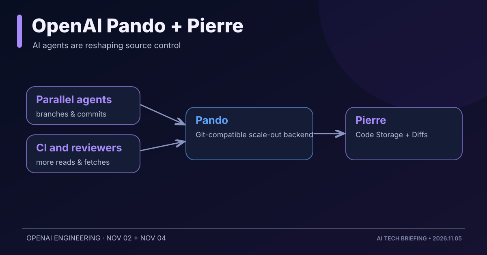
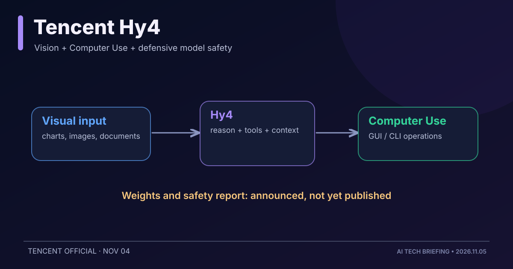
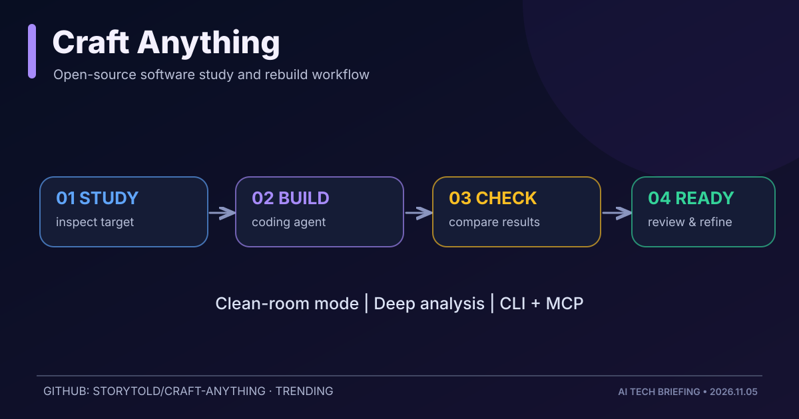
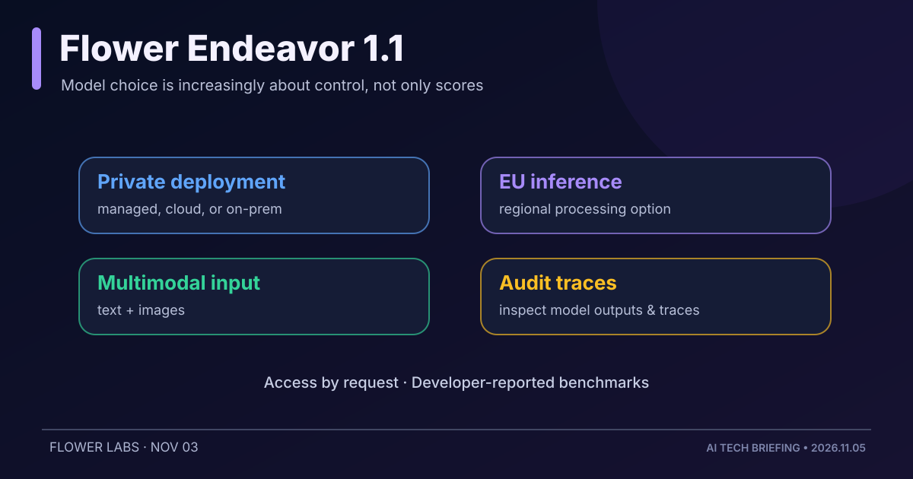
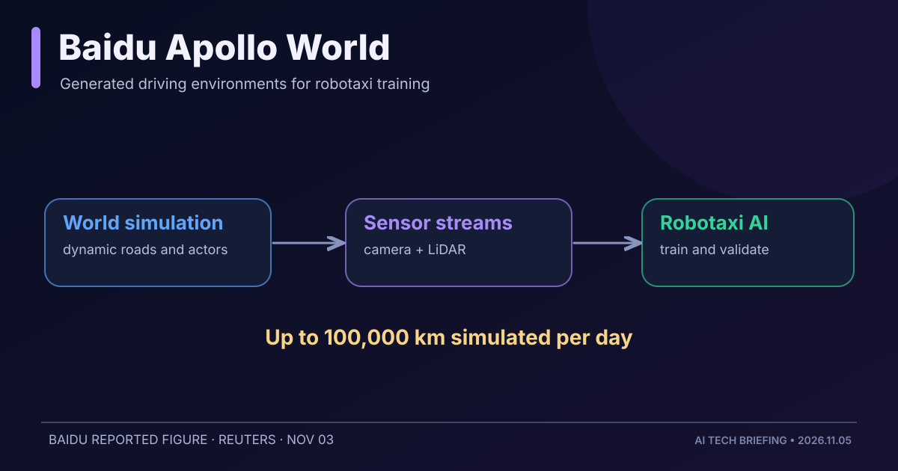

# AI·LLM·AI 에이전트·테크 비즈니스 3일 브리핑

**발행 시각:** 2026-11-05 08 KST  
**조사 범위:** 2026-11-02 08:00～2026-11-05 08:00 KST  
**선정:** 소프트웨어 개발 인프라 1건, 신규 AI 모델 2건, GitHub 오픈소스 1건, 피지컬 AI 1건

> **이번 핵심:** Coding Agent의 확산으로 모델의 지능만큼 **소스코드 저장·병렬 작업·검증 아키텍처**가 중요해지고 있다. 동시에 기업용 AI는 데이터 통제와 운영 위치를 경쟁력으로 내세우고 있다.

직전 회차의 DeepSeek Super-agent, Clover-35B-A3B, Mage-VL-Cowork, Vercel agent-desktop 및 OpenAI 자금 조달 전망은 재수록하지 않았다.

---

## 1. OpenAI, Git 백엔드 Pando 공개·Pierre 인수 발표 — Agent 시대의 코드 저장소 경쟁

**발표:** 11월 2일 Pando 기술 공개 / 11월 4일 Pierre 인수 계획 발표 · OpenAI

### 핵심 요약

- OpenAI는 병렬 Coding Agent의 브랜치·커밋·CI 요청이 증가하면서 기존 Git 저장소 인프라의 병목을 해결하기 위해 **Pando**를 개발했다.
- Pando는 Git 프로토콜·클라이언트와의 호환성을 유지하면서 **다수 브랜치에 대한 병렬 쓰기**, 대량의 읽기·클론 요청을 분산 처리하는 백엔드다.
- OpenAI가 공개한 자사 운영 수치에 따르면 **push 지연시간 중앙값은 약 5분의 1 수준**으로 줄었고, 하루 **거의 1PB**의 Git 데이터를 전달한다. 특정 내부 환경 측정치다.
- 이어 11월 4일 **Pierre Computer 인수 계획**을 발표했다. Pierre는 Git 기반 Code Storage와 오픈소스 **Trees·Diffs** 등 코드 탐색·리뷰 도구를 개발한다. OpenAI는 이미 Codex 앱에서 Trees와 Diffs를 이용하고 있다고 설명한다.
- 인수는 **규제 승인 등 종결 조건이 남은 계획**이며, 완료된 거래가 아니다. OpenAI는 Pierre의 기존 오픈소스 프로젝트를 계속 공개하겠다고 밝혔다.

### 왜 중요한가?

이제 병목은 코드를 쓰는 속도만이 아니다. 수십 개의 Agent가 동시에 기능을 개발하면 브랜치 생성, 충돌 해결, 코드 리뷰, CI, 이력 저장까지 확장해야 한다. **소스코드 관리가 Agent 시대의 핵심 인프라**가 되는 사례다. 아키텍처 수업이라면 동시성, 인과적 일관성, 읽기/쓰기 확장, 호환성 유지, 리뷰 책임을 연결해 설명할 수 있다.

**출처:** [OpenAI – Scaling Git at OpenAI, 11월 2일](https://openai.com/index/scaling-git-at-openai/) · [OpenAI – Pierre 인수 계획, 11월 4일](https://openai.com/index/openai-to-acquire-pierre/)

---

## 2. Tencent Hy4 출시 — 비전·GUI·CLI 조작을 더한 Agent 모델

**발표:** 11월 4일 · Tencent

### 핵심 요약

- Tencent가 **Hy4**를 발표했다. 기존 Hy4 Preview와 비교해 시각 이해, 복잡한 차트·문서 해석, 장시간 Agent 작업, 도구 호출 능력을 확장했다고 설명한다.
- 새롭게 **Computer Use**를 지원해 GUI와 명령줄 환경을 조작하는 과제를 수행하도록 설계됐다. Blender와 CAD 등 전문 도구 관련 훈련도 소개했다.
- 모델의 보안 학습에서는 공격 도구 제작 등 공격적 사이버 자료를 제외하고 **취약점 탐지·수정 중심의 방어적 데이터**를 사용했다고 밝혔다.
- **중요한 구분:** Tencent는 오픈웨이트를 지향한다고 발표했지만, **11월 5일 오전 기준 새 Hy4의 가중치와 시스템 카드는 향후 공개 예정**이라고 명시했다. 8월의 Hy4 Preview 가중치 공개와 혼동하면 안 된다.
- 보안 능력·성능 향상은 우선 개발사 주장으로, 독립 검증이 필요하다.

### 왜 중요한가?

모델이 단순한 텍스트 생성기에서 **업무용 소프트웨어를 직접 실행하는 Agent의 두뇌**로 확장되는 흐름이다. 동시에 위험한 작업을 수행할 수 있는 모델에 어떤 데이터를 학습시키고, 실행 권한을 어떻게 제한할지가 모델·시스템 양쪽의 중요한 설계 과제가 된다.

**출처:** [Tencent – Hy4 공식 발표, 11월 4일](https://www.tencent.com/tencent-launches-hy4-joining-the-ranks-of-the-worlds-leading-open-source-ai-models/) · [Reuters – 사이버보안 데이터 제한 보도, 11월 4일](https://www.reuters.com/legal/litigation/tencent-rolls-out-ai-model-trained-with-limited-cybersecurity-data-amid-hacking-2026-11-04/)

---

## 3. GitHub 화제 프로젝트 Craft Anything — 프로그램을 분석하고 새 프로젝트를 만드는 오픈소스

**주목:** 11월 초 GitHub 급상승 · [storytold/craft-anything](https://github.com/storytold/craft-anything)

### 핵심 요약

- Rust로 개발된 **Craft Anything**은 웹사이트·데스크톱 앱·게임 등을 분석하고, Coding Agent를 연결해 유사한 동작의 새 프로젝트를 만드는 도구다.
- 핵심 워크플로는 **Study → Build → Check → Ready**: 대상 분석, 새 프로젝트 구현, 원본과 비교, 검토·수정 순서다.
- 개발자가 설명하는 **320개 분석 도구**를 CLI 및 MCP 도구로 제공한다. Claude Code를 우선 지원하며 다른 Agent 연동은 일부 검증 상태가 다르다.
- 기본 **Clean-room 모드**는 외부에서 관찰 가능한 화면·동작을 바탕으로 분석하며, **Deep 모드**는 허용된 범위 내에서 코드·파일 내부를 분석한다.
- 중요한 제한: 프로젝트 측도 Clean-room은 **OS 수준 샌드박스가 아니며**, Agent의 파일 접근·실행 권한을 자동 격리하지 않는다고 설명한다. 대상 소프트웨어의 라이선스·저작권·접근 권한 확인이 필요하다.
- 11월 4일 신규 GitHub 프로젝트 급상승 목록에서 주목받았으며, GitHub 저장소는 확인 시점 **1만 개 이상의 Star**를 기록했다. 인기도는 품질과 안전성을 보증하지 않는다.

### 왜 중요한가?

Coding Agent의 역할이 코드를 새로 작성하는 데서 **기존 소프트웨어 관찰 → 요구사항 추론 → 구현 → 결과 비교**로 확장되는 사례다. 개발자가 소스코드보다 **동작 명세와 검증 기준**을 관리하는 일이 더욱 중요해질 가능성을 보여준다.

**출처:** [공식 GitHub 및 README](https://github.com/storytold/craft-anything) · [11월 4일 GitHub 상승 프로젝트 추적](https://trendar.org/)

---

## 4. Flower Endeavor 1.1 — EU 추론·프라이빗 배포·추론 기록 통제를 내세운 기업용 모델

**발표:** 11월 3일 · Flower Labs

### 핵심 요약

- Flower Labs가 **Endeavor 1.1**을 공개했다. 이전 버전에서 **이미지 입력**을 추가하고 고난도 추론·코딩 성능을 개선했다고 설명한다.
- 제공 방식은 **Flower 관리형 서비스, 프라이빗 클라우드, 온프레미스**이며, **EU 내 GPU에서 추론**하는 옵션도 신설했다.
- 고객이 결과물과 추론 기록을 보유하고 감사·내부 모델 학습에 활용할 수 있도록 하는 점을 강조한다.
- 개발사 측정치에서 GPQA는 **92.0 → 94.4**, HumanEval은 **98.2 → 99.9**로 상승했다. 서로 다른 모델과 작업을 모두 대표하는 독립 종합평가로 해석해서는 안 된다.
- **오픈웨이트 공개 모델이 아니다.** 사용은 현재 문의·접근 요청 방식으로 제공된다.

### 왜 중요한가?

기업에서 AI 모델 선택은 성능 벤치마크만의 문제가 아니다. **데이터가 어느 지역에서 처리되는지, 추론 기록을 감사할 수 있는지, 모델을 자체 인프라에서 운영할 수 있는지**가 중요한 아키텍처 결정이다. 규제 산업의 AI 서비스 구축에는 데이터 주권과 운영 통제가 직접적인 요구사항이 된다.

**출처:** [Flower Labs – Introducing Endeavor 1.1, 11월 3일](https://flower.ai/blog/2026-11-03-introducing-endeavor-1.1)

---

## 5. Baidu Apollo World 공개 — 로보택시를 위한 생성형 도로 시뮬레이션

**발표:** 11월 3일 · Baidu

### 핵심 요약

- Baidu가 자율주행 시스템을 학습시키기 위한 **Apollo World**를 공개했다.
- 생성형 시뮬레이션으로 도로와 주변 교통 참여자의 변화를 모델링하고 **카메라·LiDAR 데이터 스트림**을 제공해 자율주행 시스템이 가상 환경에서 인식·주행하도록 한다.
- Baidu는 하루 **최대 10만 km 분량의 모의 주행**을 생성할 수 있다고 주장했다. 이는 실제 도로에서 10만 km를 주행했다는 의미도, 동일한 안전성 검증을 마쳤다는 의미도 아니다.
- 이미 자사 **Apollo Go 로보택시**의 학습에 활용하고 있다고 발표했다.

### 왜 중요한가?

물리적 환경에서 경험을 축적하는 비용을 줄이기 위해 **World Model + Simulation + Agent**를 결합하는 방향이다. 시뮬레이터의 현실성과 다양성이 좋아질수록 로봇의 학습·검증을 빠르게 반복할 수 있지만, 실제 도로 성능과의 차이를 측정하는 검증 설계는 여전히 필요하다.

**출처:** [Reuters – Baidu launches Apollo World, 11월 3일](https://www.reuters.com/technology/chinas-baidu-launches-ai-model-simulating-road-environment-robotaxis-2026-11-03/)

---

## 3일간 변화 요약

| 핵심 소식 | 기술적 변화 | 아키텍처 관점 |
|---|---|---|
| OpenAI Pando + Pierre | Agent 규모의 Git 쓰기·읽기·리뷰 | 분산 저장소, 병렬 작업, 검증 |
| Tencent Hy4 | Vision + GUI/CLI Computer Use | 도구 인터페이스, 실행 권한, 안전성 |
| Craft Anything | 분석→재구현→비교를 자동화 | 관측 가능한 명세, 테스트, 라이선스 |
| Flower Endeavor 1.1 | 기업 통제형 모델 제공 | 데이터 주권, 감사, 모델 운영 |
| Baidu Apollo World | 피지컬 AI용 생성형 시뮬레이션 | 디지털 트윈, 합성 데이터, 검증 |

**종합 관찰:** 이제 AI 경쟁은 모델 하나의 점수만으로 설명되지 않는다. **모델 → 도구 → 실행환경 → 데이터·코드 저장 → 검증**의 전 과정이 차별화되고 있다. 특히 소프트웨어 아키텍처를 공부할 때는 Agent가 여러 개 병렬로 일하는 상황에서 동시성과 책임 경계를 어떻게 설계할 것인지가 유용한 질문이다.

---

*편집 주석: 본문 이미지 5개는 공개 자료에 근거하여 별도로 작성한 SVG 개념도다. 기업의 공식 제품 UI나 실측 벤치마크 그래프가 아니다. 실측 수치와 성능 주장은 출처의 자체 발표인지 독립 검증인지 구분해 기술했다.*
