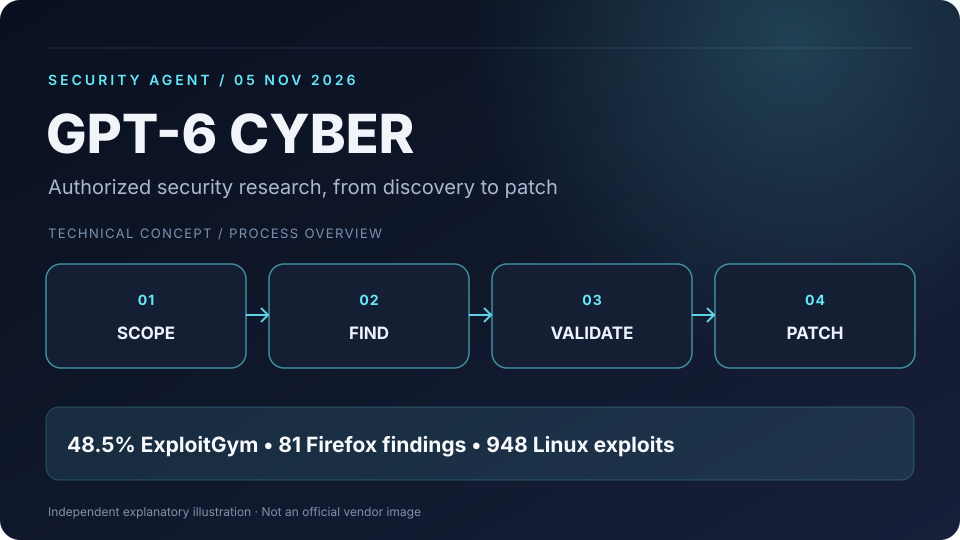
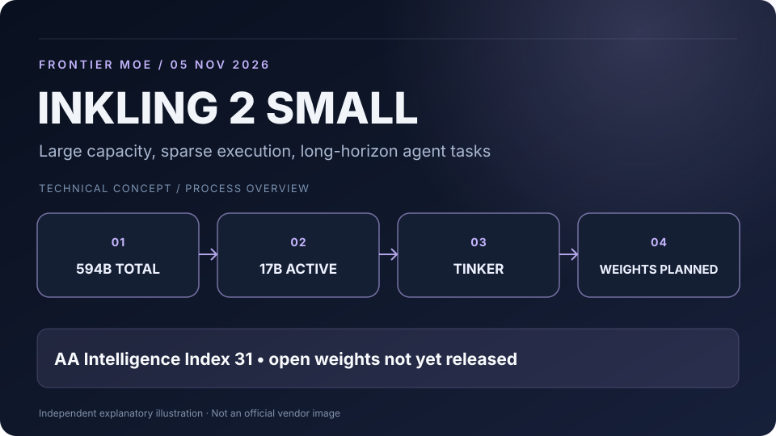
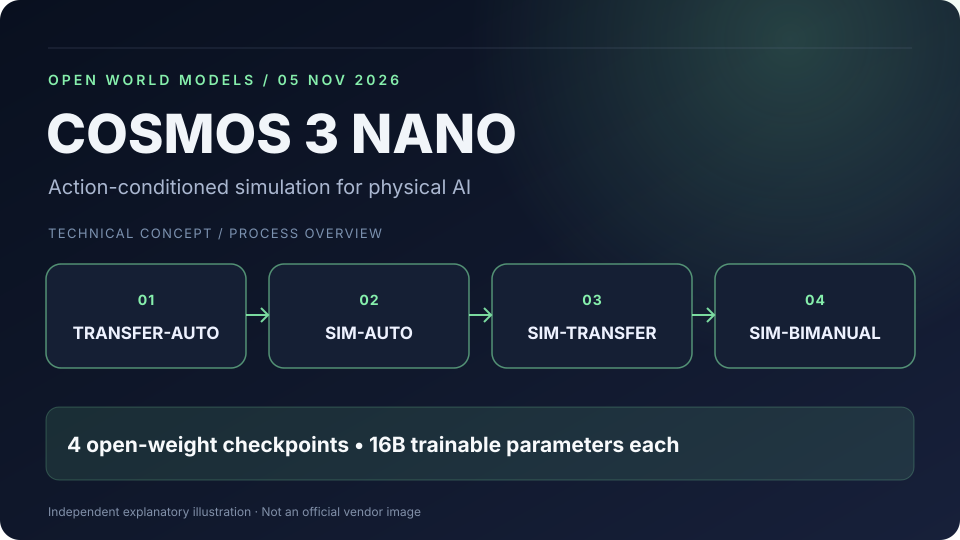
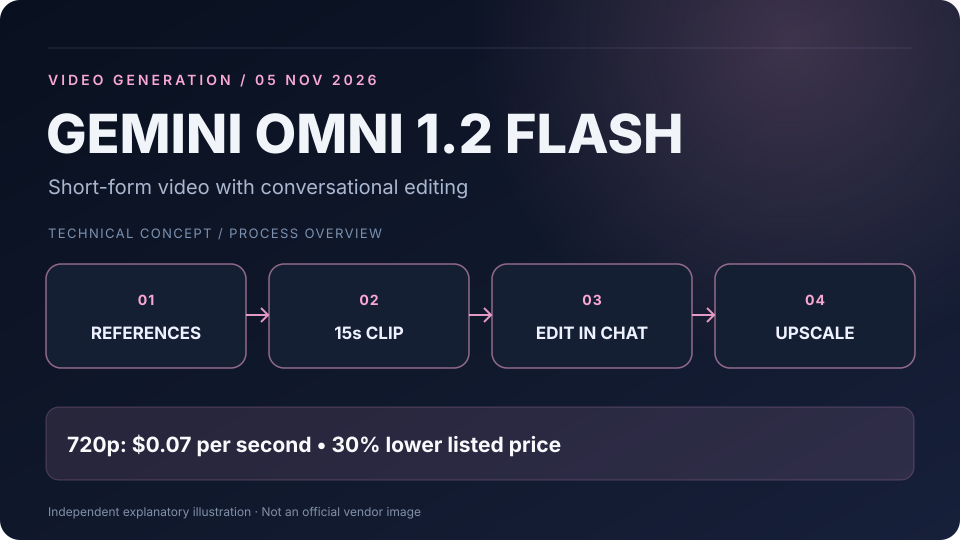
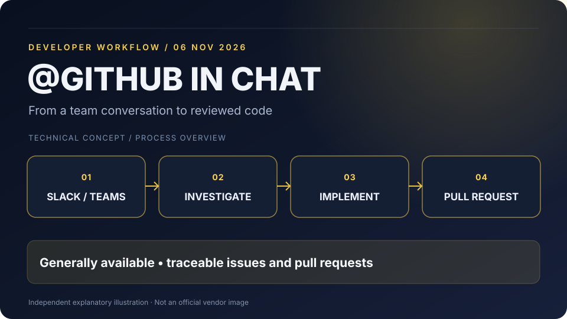

# AI·LLM·AI 에이전트·테크 비즈니스 3일 브리핑

**발행 기준:** 2026-11-08 08:00 KST  
**조사 범위:** 2026-11-05 08:00～2026-11-08 08:00 KST  
**구성:** 신규 AI 모델 3건, 오픈웨이트 월드모델 1건, Coding Agent 플랫폼 1건

> **이번 핵심:** AI는 새로운 보안 취약점을 발견하고, 장시간 코딩 작업을 이어가며, 물리 환경의 변화를 생성하고, 채팅 도구 안에서 소프트웨어 개발을 수행하는 방향으로 발전하고 있다. 하지만 이러한 능력을 안전하게 운영하는 **권한·검증·실행환경의 아키텍처**가 동시에 중요해진다.

**중복 제외:** 11월 5일 회차의 OpenAI Pando·Pierre, Tencent Hy4, Craft Anything, Flower Endeavor 1.1, Baidu Apollo World는 포함하지 않았다. 11월 4일 먼저 공개된 Perplexity Teammates도 이번 3일 집계 기간에 속하지 않아 제외했다.

**이미지 안내:** 본문 SVG 5개는 발표 내용에 기초해 별도로 제작한 기술 개념도이며 공식 제품 이미지가 아니다.

---

## 1. OpenAI, GPT-6 Cyber 출시 — Firefox 미공개 고위험 취약점 81건 발견

**발표:** 2026년 11월 5일 · OpenAI · 보안 특화 프런티어 모델

### 핵심 요약

OpenAI는 취약점 탐지·재현·패치 검증에 특화한 **GPT-6 Cyber**를 공개했다. 개발사 발표에 따르면 보안 관련 평가인 **ExploitGym 성공률은 48.5%**로 이전 GPT-5.6 Cyber의 32.1%에서 개선됐다.

- OpenAI 연구진은 모델을 이용해 **Firefox에서 미공개 고위험 취약점 81건**을 발견하고 Mozilla에 신고했으며, 일부에 대한 수정이 배포됐다.
- Linux 커널 연구에서는 여러 취약점을 재현하고 **948건에 대한 실제 작동하는 악용 코드**를 개발했다. 이는 모델의 능력을 설명하는 보안 연구 성과이지, 일반 사용자에게 악용을 권장한다는 뜻이 아니다.
- 허가받지 않은 범위를 침범하지 않은 비율은 전용 테스트에서 **99.93%**, 배포 프롬프트를 적용했을 때 **100%**로 보고됐다. 제한된 시험 결과를 절대적인 안전 보장으로 해석해서는 안 된다.
- OpenAI는 모델을 사이버보안 능력 **Critical**로 평가했으며, 현재 접근은 승인된 **Daybreak Red** 참여자로 제한한다. 모든 개발자에게 일반 공개된 모델은 아니다.

### 왜 중요한가?

소프트웨어 보안이 단순 패턴 탐지에서 **장시간의 가설 수립 → 재현 → 증거 확보 → 수정 제안**으로 확장된다. DevSecOps 파이프라인에서 보안 Agent를 활용할 가능성이 커지지만, 실행 대상과 권한을 제한하고 최종 수정은 사람이 검증하는 구조가 필수적이다.

**출처:** [OpenAI 공식 발표 · 11월 5일](https://openai.com/index/introducing-gpt-6-cyber/) · [Reuters 보도 · 11월 5일](https://www.reuters.com/technology/openai-launches-gpt-6-cyber-with-critical-cybersecurity-rating-2026-11-05/)

---

## 2. Thinking Machines, Inkling 2 Small 공개 — 594B MoE와 장시간 코딩 Agent

**발표:** 2026년 11월 5일 · Thinking Machines Lab · 신규 멀티모달 LLM

### 핵심 요약

Thinking Machines Lab이 **Inkling 2 Small**을 발표했다. 이름과 달리 대규모 희소 MoE 모델로, 모델 카드에 기재된 사양은 **전체 5,940억 파라미터 / 활성 170억 파라미터**, 최대 **100만 토큰 컨텍스트**, 텍스트·이미지 입력이다.

- 개발사에 따르면 Artificial Analysis Intelligence Index는 **31점으로 반올림**해 제시됐다. 모델 카드에 표시된 상세 점수는 **30.6점**이다.
- 코드 생성뿐 아니라 웹 UI, Three.js 기반 도시 시뮬레이터, 장시간 GPU 커널 최적화, 학습 실험 등을 사례로 소개했다.
- 모델은 현재 **Tinker에서 추론·파인튜닝 가능**하지만 **가중치는 아직 비공개**다.
- 개발사는 외부 안전성 검증 뒤 **다음 주 Apache 2.0 기반 가중치 공개를 목표**로 하고 있다. 따라서 현시점에 오픈웨이트가 이미 공개됐다고 표현해서는 안 된다.
- 공개 벤치마크 비교는 하네스와 설정에 영향을 받으며, 실제 프로젝트 성능은 별도로 검증해야 한다.

### 왜 중요한가?

모델의 총 파라미터 크기가 곧 추론 비용과 성능을 뜻하지 않는다는 것을 보여준다. MoE의 **활성 파라미터**, 컨텍스트 압축 전략, Agent 하네스, 테스트·검증 품질까지 함께 설계해야 한다. 향후 오픈웨이트가 실제 공개되면 기업의 자체 호스팅 선택지도 늘어날 수 있지만, 594B급 전체 가중치에 필요한 메모리·서빙 비용은 여전히 상당하다.

**출처:** [Thinking Machines 공식 발표 · 11월 5일](https://thinkingmachines.ai/news/inkling-2-small/) · [Inkling 2 Small 모델 카드](https://thinkingmachines.ai/model-card/inkling-2-small/)

---

## 3. NVIDIA, Cosmos 3 Nano 오픈웨이트 모델 4종 추가 — 상호작용하는 물리 세계 생성

**발표:** 2026년 11월 5일 · NVIDIA / Hugging Face · 오픈웨이트 AI

### 핵심 요약

NVIDIA가 Cosmos 3 Nano 계열에 **4개의 오픈웨이트 체크포인트**를 추가했다. 각각 **16B trainable parameters**를 갖는 도메인 특화 후학습 사례이며, **OpenMDW1.1** 라이선스 조건이 적용된다.

| 모델 | 주요 역할 |
|---|---|
| Cosmos3-Nano-Transfer-Auto | 날씨·조명·시간대가 달라진 다중 시점 주행 데이터 생성 |
| Cosmos3-Nano-Sim-Auto | 주행 제어에 반응하는 카메라·LiDAR 스트리밍 관측 생성 |
| Cosmos3-Nano-Sim-Transfer | 물리 시뮬레이터의 제어값을 사실적인 RGB 영상으로 변환 |
| Cosmos3-Nano-Sim-Bimanual | 양팔 로봇의 동작·카메라 행동에 따른 다음 영상 예측 |

NVIDIA는 모델뿐 아니라 체크포인트, 사후학습 레시피, 샘플 코드와 Agent Skill도 제공한다. **Sim-Auto의 폐루프 상호작용에는 별도의 시뮬레이션 런타임**이 필요하며, 생성된 영상이 물리적으로 정확하다는 보장은 없다.

### 왜 중요한가?

피지컬 AI는 현실에서 모든 상황을 반복 실험하기 어렵다. 이번 공개는 **행동 → 환경 변화 → 관측 → 다음 행동**을 가상으로 이어갈 수 있는 구성 요소를 오픈웨이트로 제공한다는 점에서 의미가 있다. 로봇과 자율주행의 소프트웨어 아키텍처는 모델뿐 아니라 센서 동기화, 시뮬레이션 상태, 검증 환경을 포함하게 된다.

**출처:** [NVIDIA의 Hugging Face 공식 기술 발표 · 11월 5일](https://huggingface.co/blog/nvidia/cosmos-interactive-world-simulation) · [Cosmos3 Nano 모델 컬렉션](https://huggingface.co/collections/nvidia/cosmos3)

---

## 4. Google, Gemini Omni 1.2 Flash 출시 — 15초 영상 생성·대화형 수정·30% 가격 인하

**발표:** 2026년 11월 5일 · Google DeepMind · 신규 영상 생성 모델

### 핵심 요약

Google이 영상 생성 모델 **Gemini Omni 1.2 Flash**를 정식 제공하기 시작했다.

- 네이티브 영상 생성 길이를 이전 **10초에서 최대 15초**로 확장했다. 길이는 3～15초 범위에서 1초 단위로 지정할 수 있다.
- 참조 이미지·짧은 동작 영상·음성 힌트를 결합하는 기능과 인물·제품·장면의 일관성을 개선했다고 설명한다.
- 결과물을 처음부터 다시 생성하지 않고 **대화형 후속 요청으로 수정**할 수 있다.
- Google 발표에 따르면 720p 기준 가격은 **초당 $0.07**, Gemini Omni 1.1 대비 **30% 인하**됐다. 1080p 또는 4K 업스케일 작업도 제공한다.
- Gemini API와 비즈니스용 환경에서 일반 제공된다. 품질 개선은 우선 개발사 발표를 기준으로 한다.

### 왜 중요한가?

영상 생성이 1회성 파일 출력에서 **반복 수정 가능한 제작 파이프라인**으로 바뀌고 있다. 웹·앱 개발자는 브랜드 이미지, 상품 사진, 짧은 영상, 후편집을 결합하는 자동화 서비스를 설계할 수 있다. 비용 관점에서는 초당 과금, 반복 생성 횟수, 업스케일 비용을 분리해 계산할 필요가 있다.

**출처:** [Google 공식 발표 · 11월 5일](https://blog.google/innovation-and-ai/technology/developers-tools/introducing-gemini-omni-1-2-flash/)

---

## 5. GitHub `@GitHub`, Slack·Teams에서 정식 제공 — 채팅에서 Issue·수정·PR까지

**발표:** 2026년 11월 6일 · GitHub · Coding Agent 및 개발 협업

### 핵심 요약

GitHub가 Slack 및 Microsoft Teams 안에서 `@GitHub`로 시작하는 개발 작업 기능을 **일반 제공**으로 전환했다.

- 팀 채팅에서 버그를 조사하고 Issue를 만들거나 코드를 수정하며 Pull Request를 생성하는 작업을 요청할 수 있다.
- Teams의 Canvas에서 구현 계획, 코드 변경, 프리뷰를 확인하고 동료와 피드백을 주고받는 기능을 제공한다.
- 대화 내용에서 대상 저장소를 추론해 코딩 세션을 시작하는 절차를 간소화했다.
- 생성된 Issue와 PR에는 해당 작업이 어떤 Slack·Teams 대화에서 출발했는지 출처 정보가 표시된다.
- 정식 제공은 **기능 출시 상태**를 뜻하며, 모든 팀의 구독·관리자 정책에서 별도 설정 없이 즉시 사용할 수 있다는 뜻은 아니다.

### 왜 중요한가?

개발의 시작점이 IDE나 GitHub Issue 화면에만 머무르지 않는다. **팀 대화 → 작업 명세 → Agent 구현 → PR → 사람의 리뷰**라는 흐름을 하나의 업무 인터페이스로 연결한다. 앞으로 소프트웨어 아키텍처에서는 Source of Truth, 책임·승인 주체, 변경 이력의 추적성을 명확히 하는 것이 더욱 중요하다.

**출처:** [GitHub 공식 Changelog · 11월 6일](https://github.blog/changelog/2026-11-06-github-copilot-in-slack-and-teams-is-generally-available/)

---

## 이번 브리핑 핵심 정리

| 소식 | 기술적 변화 | 아키텍처에 대한 시사점 |
|---|---|---|
| GPT-6 Cyber | 취약점 발견·검증 자동화 | 권한 범위·샌드박스·감사 |
| Inkling 2 Small | 대규모 희소 MoE·장시간 코딩 | 모델 선택·서빙·Agent 하네스 |
| Cosmos 3 Nano | 행동 조건부 물리 시뮬레이션 | 센서·월드모델·검증 런타임 |
| Gemini Omni 1.2 Flash | 대화로 수정하는 짧은 영상 제작 | 반복 워크플로·초당 비용 |
| @GitHub in Slack/Teams | 대화에서 코드 변경과 PR까지 | 업무 명세·추적성·리뷰 책임 |

### 이번 회차의 판단

**GPT-6 Cyber와 Inkling 2 Small**은 모델 자체가 얼마나 복잡한 실무 작업을 수행할 수 있는지 보여준다. 반면 **NVIDIA Cosmos 3와 GitHub 통합**은 그 모델이 실제 환경에서 작동하도록 만드는 도구·시뮬레이터·업무 프로세스의 중요성을 부각한다.

소프트웨어 아키텍처 관점에서 핵심 메시지는 **모델의 성능이 높아질수록, 모델이 어디서 무엇을 할 수 있는지 제한하고 결과를 어떻게 검증할 것인지 설계하는 역량도 함께 중요해진다**는 것이다.

---

_작성 기준은 2026년 11월 8일 08시 KST이며, 발표 시점과 실제 제품·가중치의 제공 상태를 구분했다. 개발사가 공개한 수치에는 독립 검증이 필요한 항목이 포함된다._
