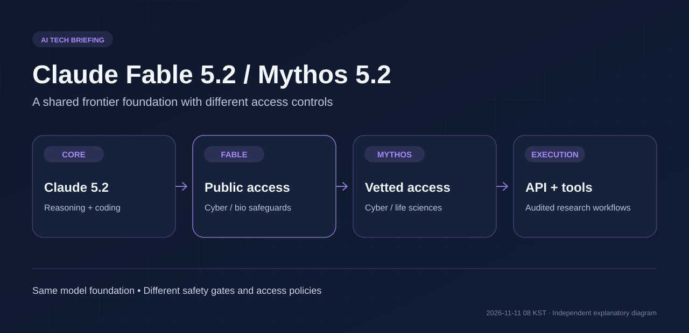
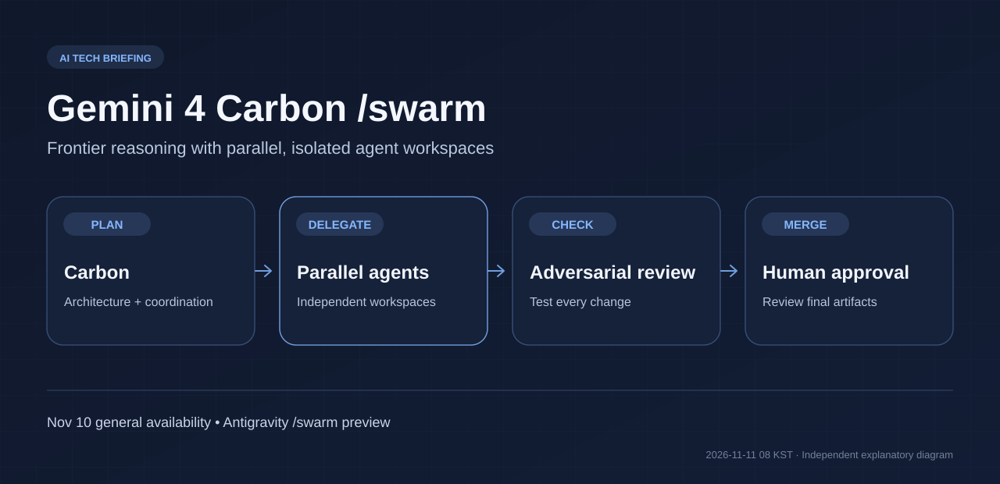
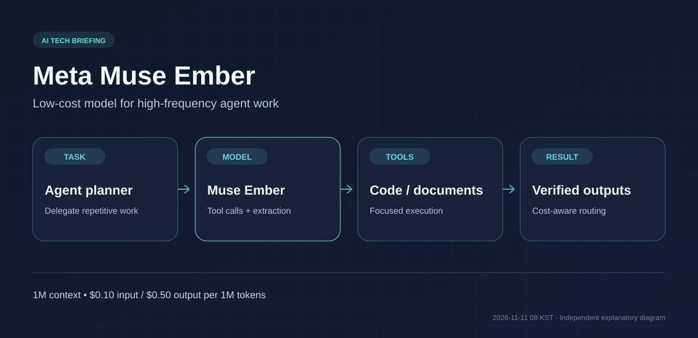
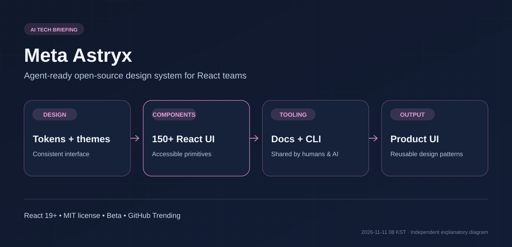
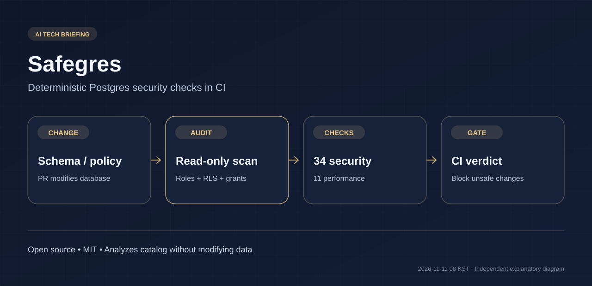

# AI·LLM·AI 에이전트·테크 비즈니스 3일 브리핑

**발행 기준:** 2026-11-11 08:00 KST  
**조사 기간:** 2026-11-08 08:00～2026-11-11 08:00 KST  
**구성:** 신규 프런티어 모델 2건, 고효율 Agent 모델 1건, GitHub 오픈소스 프로젝트 2건

> **이번 핵심:** AI 시스템의 경쟁은 단일 모델의 성능을 넘어, **고난도 작업용 프런티어 모델과 저비용 실행 모델을 조합하고**, AI가 만드는 소프트웨어의 **UI 품질과 데이터 접근 권한을 자동 검증하는 아키텍처**로 확장되고 있다.

**중복 제외 원칙:** 직전 11월 8일 회차의 GPT-6 Cyber, Inkling 2 Small, Cosmos 3 Nano, Gemini Omni 1.2 Flash, @GitHub 발표는 반복하지 않는다. Gemini 4 Carbon은 10월 28일 최초 공개됐으나, **11월 10일 일반 제공 및 /swarm 공개 프리뷰라는 중대한 업데이트**가 확인돼 다시 선정했다.

**이미지 주석:** 본문 SVG 5개는 공개 자료를 기반으로 직접 구성한 설명용 도식이다. 각 회사의 공식 스크린샷이나 성능 검증 이미지가 아니다.

---

## 1. Anthropic, Claude Fable 5.2·Mythos 5.2 발표 — 최상위 모델의 속도·가격·접근 정책 변화



**발표일:** 2026-11-09 · **분류:** 신규 프런티어 LLM

### 핵심 요약

Anthropic이 코딩, 고난도 추론, 과학·공학 연구에 특화한 **Claude Fable 5.2와 Mythos 5.2**를 발표했다. 두 제품은 **기반 모델은 같지만 접근 정책과 안전장치가 다르다**. Fable은 일반적인 Claude·API 사용자에게 제공되며, Mythos는 보안·생명과학 연구 목적으로 심사를 통과한 조직을 대상으로 한다.

- 이전 5.1 모델보다 **출력 생성속도가 최대 30% 개선**됐다는 개발사 설명.
- API 기본 가격: **입력 100만 토큰당 $8, 출력 100만 토큰당 $40**. 별도 고속 모드는 **$16 / $80**이며, 토큰 생성속도가 최대 2.5배 향상될 수 있다.
- Fable은 AWS, Google Cloud, Microsoft Azure와 Claude 플랫폼에서 이용 가능하다. Mythos 접근은 검증 프로그램이 필요하다.
- Anthropic은 소프트웨어 마이그레이션, 회로 설계, 이론물리 연구 등의 시험 사례를 공개했으나, **실험 성과를 일반 작업의 성공률과 동일시해서는 안 된다**.
- Anthropic은 대부분의 일반 개발 업무에는 Opus 5.5부터 사용하고, 난도가 높은 경우 Fable 또는 Mythos를 고려하도록 권고한다.

### 왜 중요한가?

기업 Agent가 다루는 작업을 **경제적인 일상 모델과 고난도 전문 모델로 나눠 라우팅**하는 것이 중요해진다. 또 하나의 모델에 안전 정책을 다르게 적용해 공개 접근과 제한 접근을 구분하는 사례다. 모델을 바꾸는 기준뿐 아니라 **업무 유형, 위험도, 비용, 승인 권한**을 시스템 차원에서 설계해야 한다.

**출처:** [Anthropic 공식 발표 — 2026-11-09](https://www.anthropic.com/claude-fable-and-mythos-5-2)

---

## 2. Google Gemini 4 Carbon 일반 제공 — Antigravity의 멀티 Agent `/swarm` 프리뷰



**업데이트일:** 2026-11-10 · **분류:** 기존 모델의 중대한 출시·기능 확장

### 핵심 요약

Google은 10월 28일 일부 보안 연구자에게 먼저 공개했던 **Gemini 4 Carbon을 11월 10일부터 유료 개발자·기업 및 Google AI Ultra 구독자에게 확대 제공**한다고 발표했다. 중요한 추가 기능은 Antigravity의 **`/swarm` 프리뷰**다.

- 사용자의 단일 지시를 **서로 분리된 작업공간의 여러 Agent**에게 분산하고 작업 상태를 추적한다.
- Carbon을 아키텍처 설계·조정·감사 등 고난도 역할에 사용하고, 상대적으로 가벼운 모델을 구현 작업에 배치할 수 있다.
- 독립된 검증 Agent가 변경 사항을 시험하는 작업 방식도 소개했다.
- API 도입 가격은 **입력 $2 / 출력 $10, 100만 토큰당**. 이는 현재의 **도입 가격**으로 향후 변경 가능하다.
- Google은 장기 코딩·리서치 평가 결과를 공개하지만, 실제 서비스의 비용·정확도는 작업 구성과 하네스에 따라 달라질 수 있다.

### 왜 중요한가?

기존 Coding Agent가 작업 하나를 순차적으로 수행했다면, 이제 개발 환경 자체가 **작업 분해 → 병렬 실행 → 상호 검토 → 통합**을 지원한다. 소프트웨어 아키텍처 측면에서는 독립 작업공간, 충돌 해결, 검증, 컨텍스트 공유와 권한 관리가 생산성의 핵심이 된다.

**출처:** [Google 공식 발표 — 2026-11-10](https://blog.google/innovation-and-ai/models-and-research/gemini-models/gemini-4-carbon-now-available/) · [The Verge 보도 — 2026-11-10](https://www.theverge.com/ai-artificial-intelligence/1030787/google-gemini-4-carbon-public-rollout)

---

## 3. Meta, `Muse Ember` 공개 — 반복 작업에 집중한 초저가 Agent 모델



**발표일:** 2026-11-09 · **분류:** 신규 효율 중심 LLM

### 핵심 요약

Meta가 코드 일부 수정, 도구 호출, 정보 추출, 문서 처리 등 **Agent가 자주 반복하는 작은 작업**에 특화된 **Muse Ember**를 발표했다.

| 항목 | Muse Ember |
|---|---|
| API 모델 ID | `muse-ember-1.0` |
| 입력 가격 | **$0.10 / 100만 토큰** |
| 출력 가격 | **$0.50 / 100만 토큰** |
| 캐시 입력 가격 | $0.004 / 100만 토큰 |
| 컨텍스트 | **100만 토큰** |
| 최대 출력 | 51만 2천 토큰 |
| Terminal-Bench 4.0 | **40.9%** |
| Coding Agent Index-AA | **46점** |

Meta는 Terminal-Bench 4.0에서 Claude Haiku 5.5의 39.2%를 앞섰다고 발표했다. 그러나 FrontierCode 2.0-AA에서는 Haiku 5.5가 34.9%, Ember는 27.2%여서 **모든 코딩 평가에서 우위인 것은 아니다**. 가격·성능 비교는 평가 구성과 개발사 제시 요금을 확인해야 한다.

Muse Code와 Meta Model API로 이용할 수 있다. 이 발표는 오픈웨이트 배포 공지가 아니라 **API 모델 공개**다.

### 왜 중요한가?

Agent가 파일 읽기와 테스트, 오류 수정 등을 수백 번 반복하면 개별 API 호출 요금의 차이가 전체 운영비를 크게 좌우한다. **고비용 모델은 설계와 예외 판단에, 저비용 모델은 반복 실행에** 배치하는 계층형 아키텍처가 현실적인 선택지가 된다.

**출처:** [Meta AI Research 공식 발표 — 2026-11-09](https://research.meta.ai/blog/muse-ember) · [TechCrunch — 2026-11-09](https://techcrunch.com/2026/11/09/meta-releases-muse-ember-a-new-lightweight-model-for-agent-execution/)

---

## 4. GitHub 화제 프로젝트 `meta/astryx` — 사람과 Coding Agent가 함께 쓰는 React 디자인 시스템



**주목일:** 2026-11-10 GitHub Trending · **분류:** 오픈소스·프런트엔드 개발도구

### 핵심 요약

Meta의 **Astryx**는 React 19 이상에서 사용할 수 있는 **오픈소스 UI 디자인 시스템**이다. 과거 Meta 내부에서 발전해 온 디자인 시스템을 외부 개발자와 Agent가 활용할 수 있도록 공개한 프로젝트로, **현재 Beta**다.

- 접근성을 고려한 **150개 이상의 UI 컴포넌트**, 테마, 다크 모드, CLI, 템플릿을 제공한다.
- TypeScript 기반 React 컴포넌트와 문서, 명령줄 도구를 사람이든 Coding Agent든 **동일한 방식으로 사용**하도록 설계했다.
- 스타일은 StyleX로 작성됐지만 소비자는 일반 CSS, Tailwind 등과 함께 활용할 수 있다.
- **MIT 라이선스**이며 공식 GitHub 저장소에서 유지 관리된다.
- 11월 10일 추적된 GitHub Trending 일간 상위권에 올랐으며, 추적 자료에는 약 **2만 1천 개의 누적 Star**가 기록됐다. Star 수는 시각에 따라 달라지는 인기 지표일 뿐 품질 보증은 아니다.

### 왜 중요한가?

AI에게 단지 “관리자 화면을 만들어 줘”라고 지시하는 것보다, **명확한 컴포넌트 API·접근성 규칙·테마·템플릿을 제공**할 때 결과가 일관돼질 수 있다. 소프트웨어 아키텍처 관점에서 디자인 시스템이 사람에게만 제공되던 라이브러리에서 **Agent가 재사용하는 표준 인터페이스**로 진화하는 사례다.

**출처:** [Meta Astryx GitHub](https://github.com/meta/astryx) · [GitHub Trending 일간 기록 — 2026-11-10](https://github.com/arielshakaramiro/trending-ai-repos)

---

## 5. 오픈소스 `Safegres` 공개 보도 — AI가 만든 Postgres 접근 정책을 CI에서 검증



**공개 동향:** 개발사 기술 소개 2026-11-05 · 공개 릴리스 보도 2026-11-09 · **분류:** 오픈소스·데이터 보안·DevSecOps

### 핵심 요약

Constructive가 PostgreSQL의 **Role 권한, GRANT, Row-Level Security 정책** 등을 분석해 실제 데이터 접근 범위를 점검하는 **Safegres**를 오픈소스로 공개했다. 기술 글은 11월 5일 먼저 게시됐고, **11월 9일 공개 릴리스 보도**가 발표돼 이번 회차에 포함했다.

- 데이터베이스에 **읽기 전용**으로 접근해 정책을 분석하며, 실제 데이터를 변경하지 않는다.
- **보안 34개 검사, 성능 11개 검사**를 별도 점수로 제공한다.
- Postgres 카탈로그와 SQL 구문 구조를 분석하는 **결정적 검사**를 지향한다. LLM 판단 결과로만 보안 점수를 정하지 않는다.
- CI에서 PR마다 정책 오류를 검출하고 이전 기준 대비 새롭게 생긴 위험을 차단하도록 구성할 수 있다.
- Supabase, PostgREST, Hasura 등 Postgres 기반 도구의 권한 점검에 활용할 수 있다. **MIT 라이선스**로 공개됐다.

설치와 실행의 간단한 예시는 다음과 같다.

```bash
npm i -D safegres
npx safegres doctor
npx safegres audit --perf
```

### 왜 중요한가?

AI Coding Agent가 코드를 빠르게 생성하더라도 **DB 접근 제어를 잘못 작성하면 다른 사용자의 데이터를 노출할 수 있다**. 애플리케이션 코드 리뷰만으로 DB의 실제 유효 권한을 보장하기는 어렵다. Safegres는 **코드 생성 → 마이그레이션 → 데이터 접근 권한 검사 → 배포 승인**이라는 별도의 검증 계층을 구성하는 사례다.

**출처:** [Constructive 개발사 기술 소개](https://constructive.io/blog/introducing-safegres) · [Constructive 공식 Safegres 문서](https://constructive.io/stack/safegres) · [GitHub 소스](https://github.com/constructive-io/constructive/tree/main/packages/safegres) · [11월 9일 릴리스 보도](https://www.hpcwire.com/bigdatawire/this-just-in/constructive-releases-safegres-an-open-source-verifier-for-secure-postgres/)

---

## 이번 회차 핵심 정리

| 주제 | 이번에 확인한 변화 | 아키텍처 키워드 |
|---|---|---|
| Claude Fable·Mythos 5.2 | 최상위 모델 성능·가격·접근 제어 개편 | Model Routing, Policy |
| Gemini 4 Carbon | 일반 제공과 병렬 Agent `/swarm` | Orchestration, Verification |
| Meta Muse Ember | 반복적인 Agent 작업에 특화된 저가 모델 | Cost Optimization, Subagent |
| Meta Astryx | AI와 사람이 공유하는 React UI 시스템 | Design System, Contract |
| Safegres | Postgres 보안정책의 결정적 자동 검증 | RLS, CI, DevSecOps |

### 종합 분석

**모델을 하나 고르는 것보다, 모델이 어떤 일을 맡고 어떤 도구와 검증 계층에 연결되는지가 더 중요해지고 있다.** 이 회차에서는 프런티어 모델과 소형 실행 모델의 계층화, 병렬 Agent 개발, 표준 UI 컴포넌트, 데이터 접근 보안 자동화라는 네 요소가 동시에 관찰됐다.

**추가 주시할 동향:** Google Cloud는 11월 9일 **Cloud Pathways의 GKE 일반 제공**을 발표했다. 분산 모델 학습·추론을 지원하는 인프라 변화로, 공식 설명은 [Google Cloud 발표](https://cloud.google.com/blog/topics/ai-infrastructure/cloud-pathways-a-distributed-ml-runtime-is-ga)를 참조할 수 있다. 중요성이 있지만 이번 다섯 건에는 포함하지 않았다.

---

*편집 원칙: 발표일과 보도일을 구분하고, 성능 수치는 개발사·벤치마크 조건을 명시했다. 공개 가중치 여부는 오픈소스 코드 공개와 구분했다. 뉴스 선정 기준은 한국시간 11월 8일 오전～11월 11일 오전이다.*
