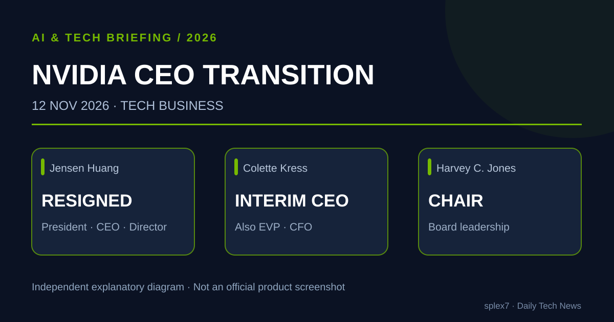
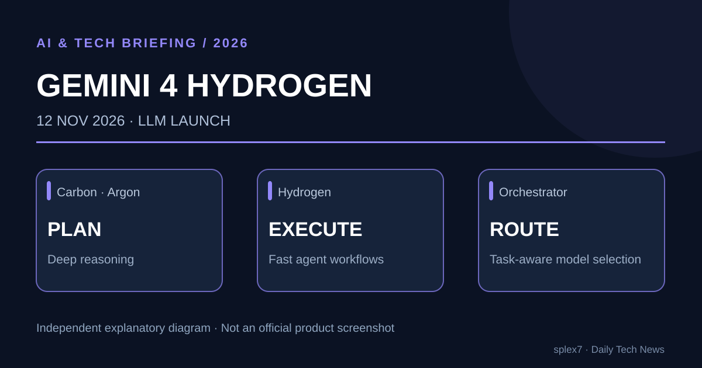
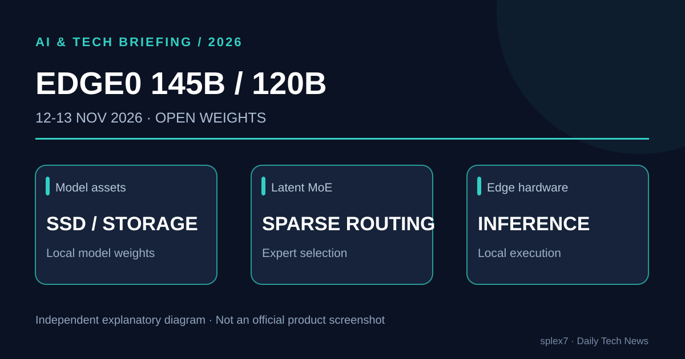
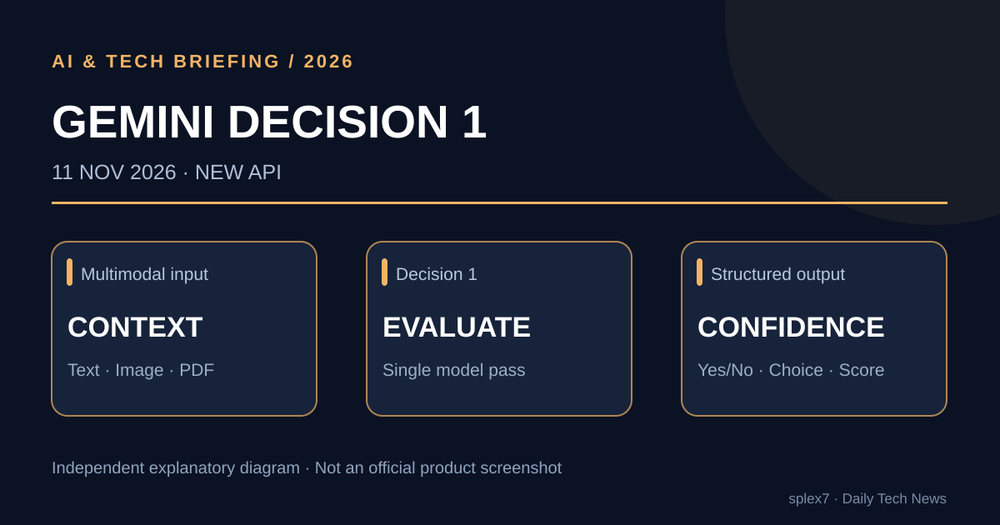
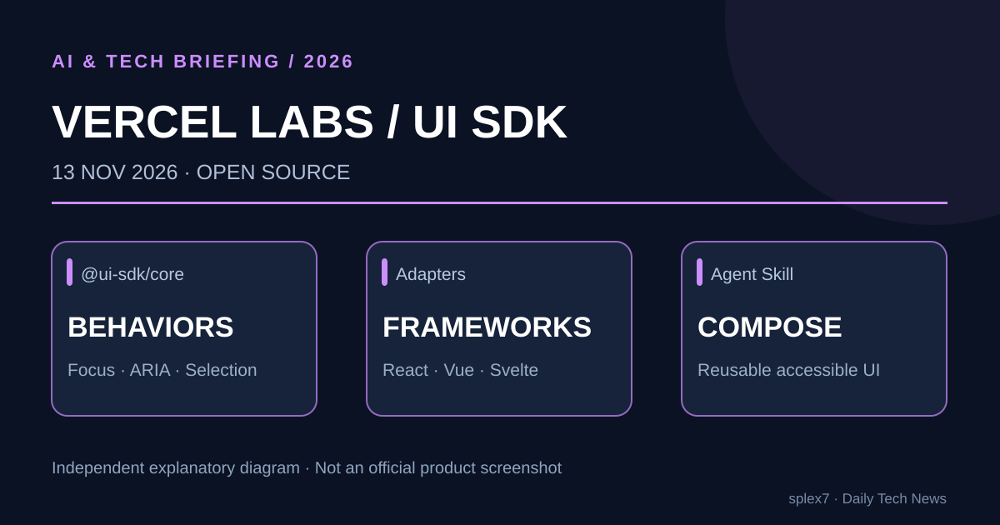

# AI·LLM·AI 에이전트·테크 비즈니스 3일 브리핑

**발행 회차:** 2026-11-14 08:00 KST  
**조사 기간:** 2026-11-11 08:00～2026-11-14 08:00, Asia/Seoul  
**선정:** 테크 비즈니스 1건, 신규 LLM·API 2건, 오픈웨이트 1건, 오픈소스 1건

> **오늘의 변화:** NVIDIA의 창업자 CEO가 물러나면서 AI 인프라 업계에 경영 불확실성이 생겼다. 그 사이 Google은 빠른 Agent 실행 모델과 판단 특화 API를 출시했고, Edge0와 Vercel Labs는 로컬 모델과 Agent 친화적인 UI 개발 도구를 공개했다.

**중복 제외:** 11월 11일 브리핑의 Claude Fable·Mythos 5.2, Gemini 4 Carbon 일반 제공 및 멀티 Agent 프리뷰, Meta Muse Ember, Meta Astryx, Safegres는 새로운 중대한 변화가 없어 반복하지 않았다.

**이미지 참고:** 본문 SVG 다섯 개는 공식 발표에 기반해 별도 제작한 기술 개념도다. 제조사의 공식 제품 이미지나 검증 자료가 아니다.

---

## 1. NVIDIA 젠슨 황 CEO 사임 — 콜렛 크레스가 임시 CEO 선임

**발표:** 2026-11-12 · **영역:** AI 인프라·테크 비즈니스

### 핵심 요약

NVIDIA는 1993년 회사 창립 이래 CEO를 맡았던 **젠슨 황 Jensen Huang이 사장, 최고경영자, 이사 직에서 즉시 사임**했다고 공식 발표했다. 최고재무책임자 **콜렛 크레스 Colette Kress**가 CFO 직을 유지하면서 임시 CEO를 맡는다. NVIDIA 이사회는 장기 후임자를 찾기 시작했으며 **하비 존스 Harvey C. Jones**를 신임 이사회 의장으로 선임했다.

- 발표문은 사임 이유를 특정하지 않았다. 원인과 관련한 언론 보도에는 확인 중인 주장들이 있으므로 이를 확정 사실처럼 다루지 않는다.
- 회사는 고객 약속, 제품 로드맵과 운영을 중단 없이 이어갈 것으로 기대한다고 밝혔다.
- Reuters는 이번 변동이 AI 반도체 업체의 성장 전략, 공급 계약과 관련 투자에 대한 불확실성을 키운다는 시장 평가를 보도했다.
- NVIDIA의 분기 실적 발표는 미국 현지 기준 **11월 17일 예정**이다.

### 왜 중요한가?

NVIDIA의 GPU, CUDA 및 관련 가속 컴퓨팅 생태계는 대규모 AI 학습·추론의 핵심 기반이다. 따라서 창업자 중심 리더십의 갑작스러운 전환은 단순 인사 문제를 넘어 **AI 클라우드 공급망과 고객 투자 전략**에 영향을 줄 수 있다. 다만 현재 공식 발표만으로 당장의 제품 개발·공급 차질을 단정할 수는 없다.

**근거:** [NVIDIA 공식 공지 — 11월 12일](https://investor.nvidia.com/news/press-release-details/2026/NVIDIA-Announces-CEO-Transition/default.aspx) · [Reuters 시장 분석 — 11월 12일](https://www.reuters.com/business/view-nvidia-ceo-jensen-huang-steps-down-2026-11-12/)

---

## 2. Google Gemini 4 Hydrogen 출시 — Agent용 고효율 모델과 Orchestrator

**발표:** 2026-11-12 · **영역:** 신규 LLM·AI Coding Agent

### 핵심 요약

Google은 **Gemini 4 Hydrogen**을 일상적인 코딩, 도구 사용, 검색, 검증 등 반복 Agent 업무에 적합한 모델로 공개했다. 기존 Gemini 4 Carbon·Argon이 고난도 추론에 집중하는 것과 대비된다.

| 항목 | 공식 발표 수치 |
|---|---|
| 입력 컨텍스트 | 최대 **100만 토큰** |
| API 가격 | **입력 $1.50 · 출력 $7.50** / 100만 토큰 |
| Terminal-Bench 4.1 | Hydrogen **57%**, Gemini 3.8 Flash **18.2%** |
| 작업 속도 | 3.8 Flash 대비 **2.5배 빠른 완료**, Google 평가 |
| Antigravity Orchestrator | Terminal-Bench 4.0에서 Carbon에 가까운 성공률을 유지하면서 **쿼터 24% 절감 · 시간 19% 절감**, Google 측정 |

새로운 **Antigravity Orchestrator**는 하나의 세션에서 Carbon과 Hydrogen을 자동 전환한다. 복잡한 계획은 Carbon이, 작업 실행과 테스트는 Hydrogen이 담당하는 구성을 지원한다. Google AI Studio, Gemini API, Gemini 앱, 검색 등으로 제공 대상을 확대했다. 수치는 모두 공식 발표의 특정 평가 조건에 기반한다.

### 왜 중요한가?

Coding Agent는 하나의 최상위 모델만 호출하는 대신 **설계·계획 모델, 빠른 실행 모델, 결과 검증 모델**을 역할별로 조합하는 방향으로 발전하고 있다. 이제 아키텍트는 개별 모델 성능뿐 아니라 전체 작업의 **완료율, 응답 지연, 비용, 접근 권한과 재시도 정책**을 최적화해야 한다.

**근거:** [Google 공식 발표 — 11월 12일, 13일 수정](https://blog.google/innovation-and-ai/models-and-research/gemini-models/introducing-gemini-4-hydrogen/) · [Google 공식 한국어 소개](https://blog.google/intl/ko-kr/company-news/technology/introducing-gemini-4-hydrogen-kr/)

---

## 3. Edge0, 145B·120B 오픈웨이트 공개 — 큰 MoE 모델의 로컬 실행

**공개:** 2026-11-12 공식 블로그, 11월 13일 GitHub 안내 · **영역:** 오픈웨이트·로컬 LLM

### 핵심 요약

Edge0가 **Edge0-145B 및 Edge0-120B** 모델의 공개 가중치와 추론 도구를 발표했다. 저비트 가중치와 희소 **Latent Mixture-of-Experts**, SSD 스트리밍 등으로 로컬 장치의 메모리 제약을 완화하는 것이 목표다.

- Edge0는 145B 모델에 대해 호환 개인 노트북 설정에서 **최대 약 29GB 메모리, 80 tokens/s 이상**을 보고했다.
- 별도의 공식 GitHub 테스트에는 **RTX 5090 D 24GB, Q3_K 양자화로 121.2 tokens/s**라는 수치가 제시돼 있다. 서로 다른 환경의 결과이므로 직접 비교하면 안 된다.
- GitHub의 최신 대형 모델 실행 가이드는 **Linux/Windows + NVIDIA CUDA 13 + edge0-strata** 환경을 안내한다. 플랫폼별 지원과 성능은 서로 다르다.
- 145B·120B는 Qwen3.8-Flash-Next 계열에서 파생됐다고 개발사가 설명한다. 구체적인 배포 및 파생 모델 이용 조건은 모델 카드와 라이선스를 별도로 확인해야 한다.

### 왜 중요한가?

온디바이스 AI가 더 큰 총 파라미터의 MoE 모델까지 확장되는 사례다. **기밀 데이터의 로컬 처리, API 호출비 절감, 네트워크 단절 상황의 실행**에 새로운 선택지가 될 수 있다. 다만 모델 전체 크기, 활성 전문가 수, 저장장치 대역폭, 실제 속도를 함께 평가해야 한다.

**근거:** [Edge0 공식 발표 — 11월 12일](https://edge0.ai/blog/introducing-edge0-145b-frontier-ai-capabilities-on-your-own-computer) · [공식 GitHub](https://github.com/Edge0-AI/Edge0) · [Hugging Face 모델 목록](https://huggingface.co/Edge0)

---

## 4. Google Gemini Decision 1 — 천 개의 질문에 저비용으로 답하는 특화 API

**발표:** 2026-11-11 · **영역:** 신규 특화 AI 모델·개발자 API

### 핵심 요약

Google이 **Gemini Decision 1**과 새로운 **Decisions API**를 출시했다. 문장을 길게 생성하는 범용 대화 모델과 달리, 선택지를 평가하여 점수와 신뢰도를 반환한다. 하나의 멀티모달 입력을 대상으로 **최대 1,000개 독립 질문**을 한 요청에 보낼 수 있다.

| 항목 | 발표 내용 |
|---|---|
| 지원 판단 | **예/아니오 · 2～255개 보기 · 단계별 평가 점수** |
| 입력 | 텍스트·이미지·음성·영상·PDF, **최대 256K 토큰** |
| 응답 시간 | Google 측정 **150～250ms** 종단간 지연 |
| 요금 | 입력 **$0.10 / 100만 토큰**, 출력 토큰 요금 없음 |
| 출시 채널 | Google AI Studio의 Gemini API |

내부적으로 일반적인 토큰별 텍스트 생성을 수행하지 않고, 후보 옵션에 대한 점수를 단일 추론 통과에서 계산한다. **도구 선택, 정책 점검, 모델 라우팅, 컨텍스트 평가**에 적합한 구성요소로 제안됐다. 확률 점수는 오류가 없다는 보증이 아니므로 임계값과 실패 시 상위 모델·사람에게 넘기는 절차가 필요하다.

### 왜 중요한가?

Agent가 매번 큰 모델에 "다음 도구는 무엇인가"를 길게 묻는 것은 비효율적일 수 있다. **빈번한 이진 판단과 분류를 특화 모델로 독립시켜 운영비와 지연을 줄이는 아키텍처**가 현실화되고 있다.

**근거:** [Google 공식 기술 발표 — 11월 11일](https://blog.google/innovation-and-ai/technology/developers-tools/gemini-decisions-api/)

---

## 5. GitHub 화제 Vercel Labs UI SDK — AI Agent가 접근성 있는 UI를 만드는 행동 프리미티브

**화제:** 2026-11-13 GitHub 급상승 · **영역:** 오픈소스·프런트엔드 개발도구

### 핵심 요약

Vercel Labs의 **UI SDK**는 화면을 그리는 컴포넌트의 형태뿐 아니라 **키보드 탐색, 포커스, 선택, 팝업, 드래그 앤 드롭, ARIA**처럼 접근성에 중요한 동작을 재사용 가능한 행동 단위로 제공하는 프로젝트다.

- 핵심 패키지 **@ui-sdk/core**에 행동을 정의하고 React, Vue, Svelte, Solid 및 Web Components용 어댑터를 제공한다.
- Coding Agent에 **UI SDK Skill**을 추가해, 컴포넌트를 만들 때 일관된 행동 규칙을 재사용하도록 설계했다.
- **Apache-2.0 라이선스**, 현재 **Beta** 단계라 API 및 문서가 변경될 수 있다.
- 11월 13일 OSS Radar 신규 급상승 프로젝트로 확인됐다. Star 수는 시점에 따라 달라지므로 성숙도와 동일시하지 않는다.

**공식 설치 예시**

    npm install @ui-sdk/react @ui-sdk/core
    npx skills add vercel-labs/ui --skill ui-sdk

### 왜 중요한가?

AI가 작성한 UI에서 겉으로는 제대로 보이지만 키보드·스크린리더 조작이 깨지는 문제를 줄이기 위한 접근이다. 이전 회차의 **Meta Astryx가 UI 컴포넌트 디자인 시스템**을 제공한다면, Vercel UI SDK는 **컴포넌트를 구성하는 행동 및 접근성 프리미티브**에 중점을 둔다.

**근거:** [공식 GitHub](https://github.com/vercel-labs/ui) · [UI SDK 사이트](https://ui-sdk.dev/) · [11월 13일 오픈소스 상승 추적](https://ossradar.net/)

---

## 종합: 3일간의 가장 중요한 변화

| 소식 | 아키텍처·산업 관점 |
|---|---|
| **NVIDIA CEO 교체** | AI 인프라의 경영 리스크와 공급망 의존도 |
| **Gemini 4 Hydrogen** | 계획용·실행용 모델을 구분한 자동 라우팅 |
| **Edge0-145B / 120B** | 대형 희소 모델의 로컬 추론 선택지 |
| **Gemini Decisions API** | Agent의 판단·분류 비용 최적화 |
| **Vercel UI SDK** | AI가 만든 UI의 행동·접근성 일관성 |

**핵심 결론:** 이제 모델 성능뿐 아니라 **어떤 모델에 어떤 일을 맡기고, 어디서 실행하며, 무엇으로 검증할 것인지**가 소프트웨어 시스템의 경쟁력을 좌우한다. 인프라 공급자 리스크까지 고려하면 모델과 실행 환경을 교체할 수 있도록 설계하는 능력도 중요하다.

---

**편집·검증 주석:** 제조사 수치와 시장 보도를 구분했으며, 모델 평가·성능 수치는 개발사 측정으로 표시했다. 위 SVG는 공식 발표 자료를 요약하여 독립 제작한 도식이다.
