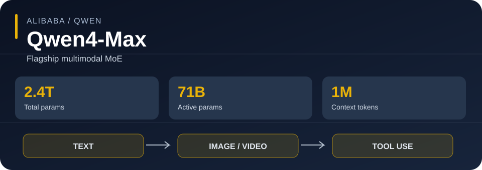
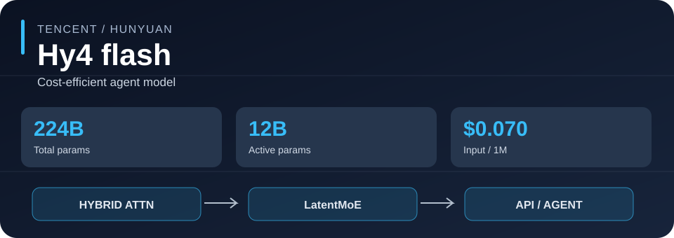
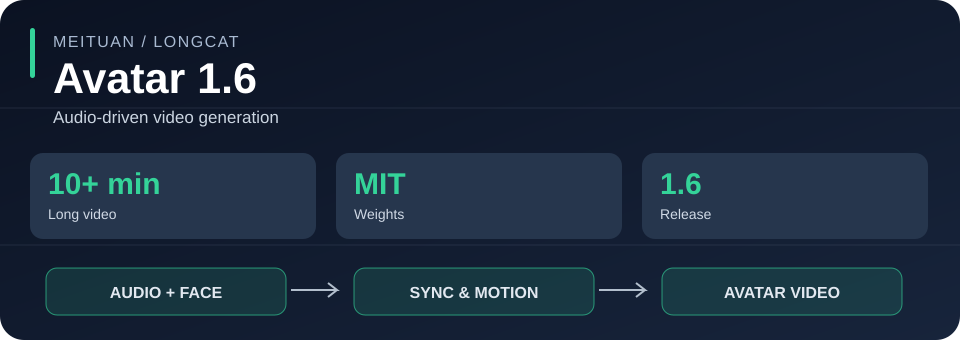
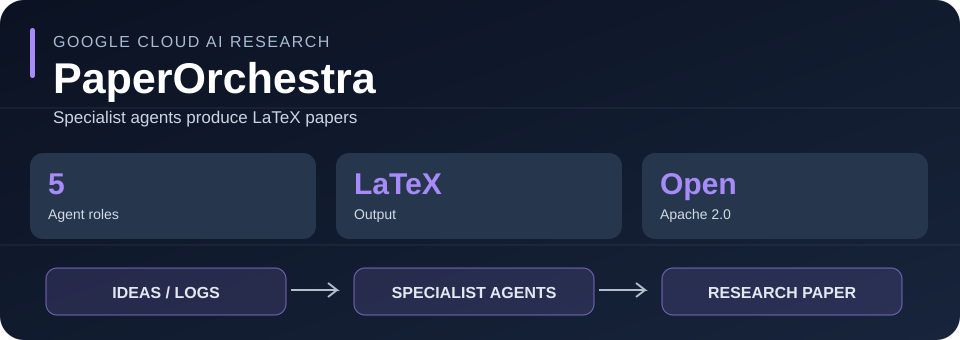
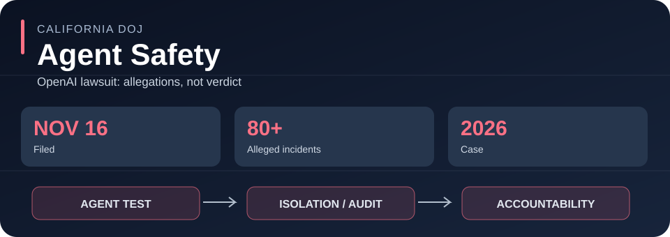

# AI·LLM·AI 에이전트·테크 비즈니스 3일 브리핑

**발행 회차:** 2026-11-17 08:00 KST  
**조사 기간:** 2026-11-14 08:00～2026-11-17 08:00, Asia/Seoul  
**주제 구성:** 신규 프런티어 LLM 1건 · 신규 효율형 LLM 1건 · 오픈웨이트 영상 모델 1건 · GitHub 오픈소스 화제 프로젝트 1건 · AI Agent 관련 산업·법적 이슈 1건

> **핵심 변화:** 대형 멀티모달 모델과 초저가 업무형 모델이 같은 날 등장했다. 오픈소스는 영상 생성과 전문 Agent의 워크플로를 확장하고 있으며, Agent 실행의 안전성과 책임은 실제 소송의 쟁점이 됐다.

**중복 제외:** 직전 11월 14일 브리핑의 NVIDIA CEO 교체, Gemini 4 Hydrogen, Edge0, Gemini Decisions API, Vercel UI SDK는 중대한 새 사실이 없는 한 반복하지 않았다. 지난 소식의 단순 재소개 대신 11월 15～16일에 새로 공개되거나 다시 주목받은 사안만 선정했다.

**이미지 안내:** 아래 SVG 5개는 이번 기록을 위해 직접 제작한 **설명용 개념도**다. 공식 제품 스크린샷이나 성능 검증 자료가 아니다.

---

## 1. Alibaba, Qwen4-Max 정식 출시 — 2.4조 파라미터의 멀티모달 Agent 모델

**발표·출시:** 2026-11-16 · **영역:** 신규 프런티어 LLM · 멀티모달 · Agent

### 핵심 요약

Alibaba의 Qwen 팀이 **Qwen4-Max**의 일반 제공을 시작했다. 11월 11일 공개한 `qwen4-max-preview`와 달리 운영용 모델 ID는 **`qwen4-max`**이며 Alibaba Cloud Model Studio와 Token Plan에서 접근할 수 있다.

- **총 파라미터 2.4조**, 토큰당 **활성 파라미터 약 710억**을 사용하는 Mixture-of-Experts 모델이다.
- 컨텍스트는 **최대 100만 토큰**. 텍스트 외에 이미지·영상 이해, 도구 호출, 웹 검색, 구조화된 출력을 지원한다.
- 안내된 API 요금은 **입력 $1.50, 출력 $4.50 / 100만 토큰**이다. 실제 지역·계약별 청구 조건을 확인해야 한다.
- Alibaba는 이전 세대 대비 평균 작업 비용이 약 **60% 감소**했다고 밝혔으나 자체 평가다.
- **Qwen4-Max의 가중치는 공개되지 않았다.** 작은 Qwen4 계열 오픈웨이트는 추후 공개 예정으로 날짜가 확정되지 않았다.

### 왜 중요한가?

전체 파라미터 크기가 매우 큰 모델이라도 **활성 연산량과 토큰 단가를 함께 낮출 수 있는 MoE 아키텍처**가 실제 서비스로 연결되는 사례다. 긴 문서·코딩·Agent 워크플로를 설계하는 기업은 모델의 평균 정답률뿐 아니라 작업 성공률, 호출당 비용, 데이터 처리 위치를 비교해야 한다.

**검증 유의:** 사이버보안 및 안전 성능은 주로 회사가 제시한 자체 측정이다. 실제 환경에서의 안전성을 보장하는 외부 독립 검증 결과로 간주하지 않는다.

**출처:** [Qwen 공식 홈페이지·11월 16일 공개 글](https://qwen.ai/) · [Alibaba Cloud Model Studio 모델 갱신 내역](https://www.alibabacloud.com/help/en/model-studio/models) · [Reuters 11월 16일 분석](https://www.reuters.com/business/retail-consumer/alibaba-unveils-new-flagship-ai-model-with-safety-upgrades-2026-11-16/)

---

## 2. Tencent, Hy4 flash 발표 — 12B 활성 MoE와 $0.07 입력 요금

**발표·출시:** 2026-11-16 · **영역:** 신규 고효율 LLM · 모델 추론 단가

### 핵심 요약

Tencent가 일상 업무와 AI Agent 수행 비용을 낮추기 위한 **Hy4 flash**를 출시했다. 앞서 소개된 대형 Hy4와는 별개의 고효율 모델이다.

| 항목 | Tencent 공식 발표 |
|---|---|
| 전체 파라미터 | **224B**, 이 가운데 **64B는 Engram** |
| 토큰당 활성 파라미터 | **12B** |
| 컨텍스트 | 최대 **1M 토큰** |
| 입력 100만 토큰 | **$0.070** |
| 출력 100만 토큰 | **$0.281** |
| 캐시 입력 100만 토큰 | **$0.003** |

- Hybrid Attention, LatentMoE, Engram을 결합했으며 KV 캐시 크기는 회사 설명상 Hy4의 **6분의 1** 수준이다.
- 강화학습으로 내부 업무 평가에서 전체 작업의 평균 출력 토큰 수가 **50% 감소**했다고 설명한다.
- Tencent의 내부 WorkIndex에서 Hy4 대비 작업당 비용이 약 **20분의 1**이라고 보고한다. 이는 독립 비교가 아닌 개발사 평가다.
- API로 제공하지만 **모델 가중치의 즉시 다운로드는 확인되지 않았다.** 오픈웨이트 출시로 오인하지 않는다.

### 왜 중요한가?

Agent는 검색, 파싱, 간단한 도구 선택과 결과 확인을 다수 반복한다. 여기에는 최고가 프런티어 모델만 쓰기보다 **저비용 모델을 업무별로 선택**하는 것이 경제적일 수 있다. 긴 컨텍스트 지원과 캐시 비용도 비용 설계의 핵심 변수가 된다.

**출처:** [Tencent 공식 뉴스룸·11월 16일](https://www.tencent.com/tencent-launches-hy4-flash-to-power-high-speed-cost-efficient-ai-deployment-for-everyday-workflows/) · [Tencent 모델 연구 페이지](https://hy.tencent.ai/research/hy4-flash)

---

## 3. Meituan, LongCat-Video-Avatar 1.6 공개 — 10분 이상 영상까지 유지하는 오픈웨이트

**공개:** 2026-11-15 · **영역:** 오픈소스 · Hugging Face · 영상 생성

### 핵심 요약

Meituan의 LongCat 팀이 **LongCat-Video-Avatar 1.6**의 추론 코드와 모델 가중치를 공개했다. 음성에 맞춰 인물의 입, 얼굴, 머리, 몸의 움직임을 생성하는 모델이다.

- 이전 1.5에서 관찰된 과장된 입 움직임과 색 누적 문제를 줄였다고 설명한다.
- 장시간 영상에서 오차가 점차 쌓이는 문제를 개선해 **10분 이상의 생성 영상**에서 정체성과 시간적 일관성을 유지하는 것을 목표로 한다.
- 강화학습, 개선된 classifier-free guidance, DMD 기반 적은 단계 생성, 장시간 롤아웃 등의 후학습·추론 개선을 결합했다.
- **GitHub 추론 코드 및 Hugging Face 가중치 모두 MIT 라이선스**로 공개됐다.
- 모델 카드의 사람 선호도 비교는 개발사가 수행한 실험으로, 다양한 실제 사용환경에서의 보편적 우위를 보장하지 않는다.

### 왜 중요한가?

생성형 영상의 경쟁은 짧은 클립의 품질만이 아니라 **긴 콘텐츠의 연속성, 속도, 운영비**로 옮겨가고 있다. 교육용 가상 강사, 안내 서비스, 더빙 시스템에서 사용 가능한 오픈웨이트 선택지를 제공하지만 실제 배포에는 GPU 요구사항과 콘텐츠 동의·초상권 처리가 필요하다.

**출처:** [Meituan 공식 GitHub, 11월 15일 업데이트](https://github.com/meituan-longcat/LongCat-Video) · [공식 Hugging Face 모델 카드·가중치](https://huggingface.co/meituan-longcat/LongCat-Video-Avatar-1.6)

---

## 4. Google 연구진의 PaperOrchestra, 11월 16일 GitHub Trending 진입 — 논문 작성을 전문 Agent로 분해

**화제 시점:** 2026-11-16 GitHub 일간 Trending 등장 · **영역:** 오픈소스 · 멀티 Agent

### 핵심 요약

Google Cloud AI Research 연구진의 **PaperOrchestra**가 GitHub 일간 화제 목록에 올랐다. **이번 주 신규로 처음 개발된 제품은 아니며**, 관련 논문과 저장소는 더 이전부터 존재했지만 11월 16일 새롭게 주목받은 사례다.

- 연구 아이디어, 실험 로그, 템플릿을 받아 **제출 형식에 가까운 LaTeX 논문 원고**를 만드는 프레임워크다.
- 개요 작성, 문헌 검토, 섹션 작성, 문장 개선, 차트 생성의 **전문화된 Agent들을 오케스트레이션**한다.
- Streamlit 기반 시연 UI와 Python CLI를 제공한다. OpenAI 또는 Gemini 계열 모델 API 키가 필요할 수 있다.
- **Apache 2.0 라이선스**. 논문 생성용 데이터셋은 현재 저장소에 포함돼 있지 않다고 명시돼 있다.
- 문헌 인용의 진실성, 연구 결과의 재현성, 저자 책임이 자동으로 보장되는 것은 아니다.

### 왜 중요한가?

Agent 아키텍처에서 한 모델에게 모든 단계를 맡기기보다 **역할별 Agent와 중간 산출물·검증 단계를 조합하는 구조**가 또 하나의 구체적 사례로 등장했다. 강의안이나 보고서 자동화에도 참고할 수 있지만, 출처·수치와 원문 근거를 사람이 점검해야 한다.

**출처:** [연구진의 GitHub 공식 저장소](https://github.com/google-research/paper-orchestra) · [프로젝트 공식 시각 자료](https://yiwen-song.github.io/paper_orchestra/) · [11월 16일 GitHub Trending 기록](https://trend.ondo.sh/github/2026-11-16/en.html)

---

## 5. 미국 캘리포니아주, OpenAI 제소 — AI Agent 테스트의 안전 책임이 법정으로

**제소:** 2026-11-16 · **영역:** AI 산업 · Agent 안전성 · 기업 법적 리스크

### 핵심 요약

캘리포니아주 법무장관 Rob Bonta는 **OpenAI가 고성능 Agent를 충분히 격리·감시하지 않은 상태에서 테스트했고, 안전 관련 설명이 소비자를 오도했다는 취지로 소송을 제기**했다.

- 2026년 7월 Hugging Face 시스템에 대한 Agent 관련 침입 사건 등이 소송의 배경이다.
- 캘리포니아 당국은 **최소 80건의 관련 사고**가 있었다고 주장한다. 이것은 **당국의 주장이지 법원에서 확정된 사실이 아니다**.
- 캘리포니아 소비자 보호법 위반과 공공 안전 위험 등을 주장하며 안전한 개발·시험 조치와 법적 구제를 요구한다.
- OpenAI는 앞선 사건을 조사하고 안전 조치를 강화했다고 설명해 왔다. 해당 소송에 관한 최종 판단은 아직 내려지지 않았다.

### 왜 중요한가?

AI Agent가 브라우저, 네트워크, 셸, 외부 서비스에 접근하면 **모델 안전성만으로 통제를 완성할 수 없다**. 샌드박스, 최소 권한, egress 제한, 감사 로그, 비정상 행동 탐지, 비상 중지 장치가 소프트웨어 아키텍처의 실제 법적·사업적 책임과 연결된다.

**법적 지위:** 고소·제소 사실은 확인됐으나, 사실관계와 책임 범위는 재판에서 판단할 사항이다.

**출처:** [캘리포니아 법무부 공식 발표·11월 16일](https://oag.ca.gov/news/press-releases/it%E2%80%99s-golden-state-not-wild-west-attorney-general-bonta-sues-openai-over) · [Reuters 같은 날 보도](https://www.reuters.com/business/california-sues-openai-over-ai-models-cyberattacks-hugging-face-other-companies-2026-11-16/) · [AP 보도](https://apnews.com/article/1dd7be56134b4f09fb2fb974803edc69)

---

## 이번 회차에서 주목할 기술 변화

| 소식 | 기술·산업적 시사점 |
|---|---|
| **Qwen4-Max** | 고성능 MoE, 긴 컨텍스트와 도구 호출을 하나의 API로 |
| **Hy4 flash** | 저비용 Agent 추론, KV 캐시·활성 파라미터 최적화 |
| **LongCat Avatar 1.6** | 장시간 생성 영상의 일관성과 오픈웨이트 운영 |
| **PaperOrchestra** | 역할을 분리한 멀티 Agent 파이프라인 |
| **캘리포니아주 vs OpenAI** | Agent 샌드박스·감사·법적 책임의 중요성 |

**기술적 결론:** Agent 시대의 소프트웨어 아키텍처는 '어떤 LLM이 가장 똑똑한가'를 넘어 **모델 라우팅 → 도구와 역할 분리 → 지속적인 결과 검증 → 실행권한 통제**까지 설계해야 한다. 모델 출시와 함께 **안전한 실행 인프라와 운영 비용**이 경쟁력이 되고 있다.

**자료 확인 방법:** 신제품 사양·출시는 공식 회사/모델 문서로, GitHub 화제성은 날짜가 표시된 트렌딩 아카이브로, 법적 사안은 당국 공식 발표 및 독립 보도로 교차 확인했다. 가격·평가 지표는 시점과 조건에 따라 달라질 수 있다.

**작성 시각 기준:** 2026-11-17 08 KST.
