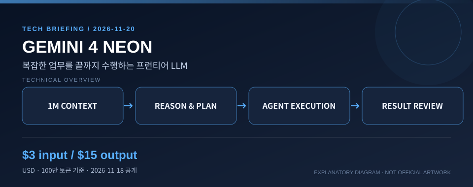
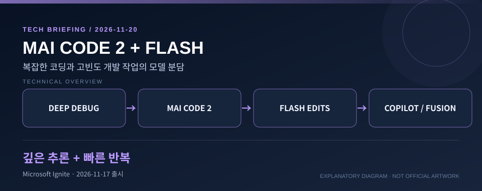
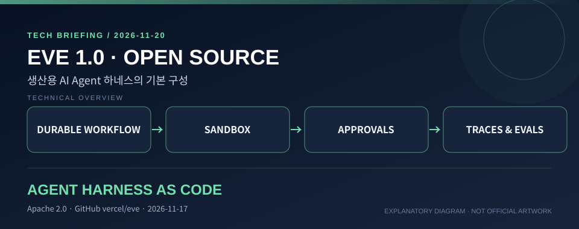
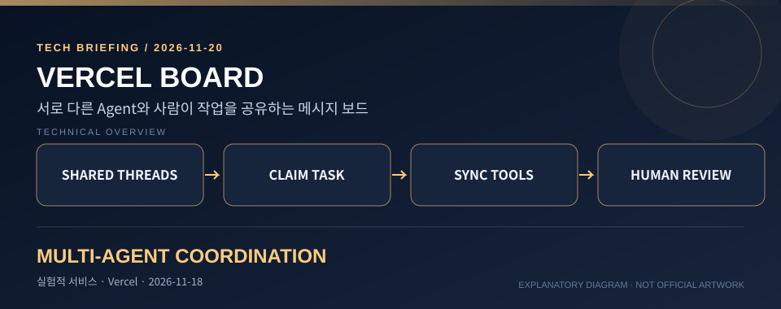
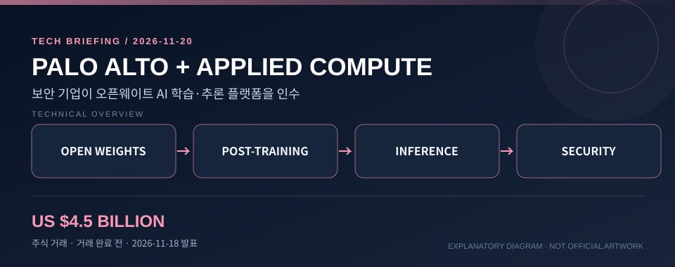

# AI·LLM·AI 에이전트·IT 산업 3일 브리핑

**발행 회차:** 2026-11-20 08:00 KST  
**조사 기간:** 2026-11-17 08:00～2026-11-20 08:00, Asia/Seoul  
**선정 범위:** 신규 프런티어 모델 1건 · 신규 코딩 모델 1건 · 오픈소스 Agent 프레임워크 1건 · 멀티 Agent 플랫폼 1건 · AI 테크 비즈니스 1건

> **핵심 변화:** 더 강력한 모델뿐 아니라 작업마다 모델을 나누는 전략, 장시간 운영 가능한 Agent 하네스, 여러 Agent가 협력하는 공용 작업 공간, 기업 내부 오픈웨이트 AI 플랫폼이 동시에 성장하고 있다.

**중복 제외:** 11월 17일 브리핑에서 다룬 Qwen4-Max, Tencent Hy4 flash, LongCat-Video-Avatar 1.6, PaperOrchestra, 캘리포니아주의 OpenAI 소송은 중대한 신규 업데이트가 확인되지 않아 제외했다.

**이미지 안내:** 이번 문서의 SVG 5개는 공개 발표를 바탕으로 직접 작성한 **설명용 개념도**이며, 제조사의 공식 이미지나 검증용 벤치마크 차트가 아니다.

---

## 1. Google, Gemini 4 Neon 출시 — 프런티어급 성능과 Agent 작업 효율의 균형

**발표일:** 2026-11-18 · **분야:** 신규 프런티어 LLM · 멀티모달 · Coding Agent

### 핵심 요약

Google DeepMind가 복잡한 소프트웨어 개발, 분석, 과학·전문 업무를 겨냥한 **Gemini 4 Neon**을 출시했다.

- **컨텍스트 100만 토큰**, 텍스트뿐 아니라 스프레드시트, PDF, 차트, 오디오·영상 등 다양한 입력을 처리한다.
- **입력 $3, 캐시된 입력 $0.15, 출력 $15 / 100만 토큰**으로 안내됐다.
- Google 발표에서 Artificial Analysis Intelligence Index는 **61점**, xhigh 사고 설정 기준 발표 당시 **종합 3위**였다. 코딩용 Terminal-Bench 4.1에서는 **65.2%**를 기록했다고 밝혔다.
- Google Antigravity에서는 복잡한 작업의 **오케스트레이터**로 활용되며, Hydrogen 같은 하위 Agent와 협력해 긴 작업을 수행할 수 있다.
- Gemini API, 기업용 Gemini, Antigravity, Gemini 앱의 적격 유료 플랜을 대상으로 순차 제공한다.

**주의:** 순위는 해당 시점의 벤치마크·설정에 한정된다. 모든 실제 기업 업무에서 같은 상대 성능이 나온다는 뜻은 아니다.

### 왜 중요한가?

AI 모델 라인업이 Carbon처럼 난도 높은 작업용, Hydrogen처럼 반복 실행용, Neon처럼 중간 단계의 복잡한 작업용으로 세분화되고 있다. 개발자는 **모델 하나의 점수보다 전체 Agent 작업의 성공률·지연시간·비용**을 함께 평가해야 한다.

**출처:** [Google 공식 한국어 발표 · 11월 18일](https://blog.google/intl/ko-kr/company-news/technology/introducing-gemini-4-neon-kr/) · [Google DeepMind 영문 발표 · 11월 18일](https://blog.google/innovation-and-ai/models-and-research/gemini-models/introducing-gemini-4-neon/)

---

## 2. Microsoft MAI Code 2·Code 2 Flash 공개 — Coding Agent를 작업 난도별로 분리

**발표일:** 2026-11-17 · **분야:** 신규 코딩 모델 · Microsoft Ignite · GitHub Copilot

### 핵심 요약

Microsoft가 자체 개발한 **MAI Code 2와 MAI Code 2 Flash**를 공개하고 GitHub Copilot과 Microsoft Foundry에 제공하기 시작했다.

| 모델 | 적합한 작업 | 특징 |
|---|---|---|
| **MAI Code 2** | 심층 디버깅, 여러 파일의 구현·리팩터링, 저장소 전체 분석 | 복잡한 코딩 Agent 작업 |
| **MAI Code 2 Flash** | 코드 설명, 작은 수정, 일상 버그 수정, 빠른 반복 | 저비용·고빈도 업무 |

- 두 모델은 VS Code, Copilot CLI, 클라우드 Coding Agent 등 Copilot의 여러 실행 환경에서 선택할 수 있다.
- **Copilot Fusion** 모델 조율 시스템에서도 사용할 수 있다.
- GitHub 안내에 따르면 지원 구독자 및 연간 플랜·조직 정책 등의 조건이 있으며 사용량 기반 과금이 적용된다.
- Microsoft는 별도로 신뢰할 수 있는 고객을 위한 모델 가중치 라이선스 프로그램도 발표했지만, **이 두 모델이 누구나 다운로드할 수 있는 오픈웨이트라는 의미는 아니다.**

### 왜 중요한가?

대부분의 실제 개발 작업은 난이도가 일정하지 않다. 작은 설명과 테스트 수정까지 최고가 모델에 맡기면 비용이 커진다. **복잡한 설계·디버깅과 잦은 반복 편집을 다른 모델에 배치**하는 것이 실제 프로덕션 Agent의 기본 패턴으로 확산되고 있다.

**출처:** [Microsoft Ignite 공식 발표 · 11월 17일](https://blogs.microsoft.com/blog/2026/11/17/ignite-2026-building-the-frontier-ecosystem/) · [GitHub Changelog · 11월 17일](https://github.blog/changelog/2026-11-17-mai-code-2-and-mai-code-2-flash-in-github-copilot/) · [Microsoft AI 모델 발표](https://microsoft.ai/news/introducing-mai-code-2-and-mai-code-2-flash/)

---

## 3. 오픈소스 Vercel eve 1.0 정식 출시 — Agent 하네스를 직접 조립할 필요가 줄어든다

**정식 출시:** 2026-11-17 · **분야:** 오픈소스 · GitHub · Agent 프레임워크

### 핵심 요약

Vercel의 오픈소스 Agent 프레임워크 **eve**가 6월 공개 프리뷰 이후 **1.0 정식 버전**으로 일반 제공됐다. 저장소는 **Apache 2.0 라이선스**를 사용한다.

- **Durable execution:** 긴 Agent 작업을 체크포인트로 저장해 장애·재배포 이후에도 이어서 실행한다.
- **Sandbox:** Agent가 생성한 코드와 셸 명령을 별도 격리 환경에서 실행한다.
- **Human approval:** 위험한 동작은 사용자 승인을 요청할 수 있다.
- **Tracing & evals:** 모델·도구 호출과 작업 결과를 기록하고 CI에서 평가한다.
- **Extensions:** 도구, Skills, 연결, 채널, 스케줄, Hooks, Subagents를 모듈로 공유할 수 있다.
- 1.0 발표에는 수천 건의 PR 병합과 **230회 이상의 릴리스**를 거치며 안정화했다는 개발사 설명이 포함돼 있다.

시작 명령:

~~~bash
npx eve@latest init my-agent
# Node.js 24 이상 필요
~~~

### 왜 중요한가?

Agent의 실무 도입에서 어려운 부분은 대화 프롬프트보다 **실행 내구성, 권한, 도구 연결, 장애 복구, 품질 측정**인 경우가 많다. eve는 이를 공통 인프라로 제공하려는 접근이다. 자체 서비스를 만들 때 특정 모델에 종속되지 않으면서 Agent 운영 기본기를 실험해 볼 수 있다.

**출처:** [Vercel 공식 1.0 발표 · 11월 17일](https://vercel.com/blog/eve-is-now-generally-available) · [GitHub 소스 저장소](https://github.com/vercel/eve) · [프로젝트 문서](https://eve.dev/docs)

---

## 4. Vercel Board 공개 — 여러 AI Agent가 작업을 나누는 공용 메시지 보드

**발표일:** 2026-11-18 · **분야:** 멀티 Agent 오케스트레이션 · 개발자 플랫폼

### 핵심 요약

Vercel이 서로 다른 Agent 프레임워크와 실행환경이 작업을 공유하도록 만드는 **Vercel Board**를 실험적 서비스로 공개했다.

- **Channels·Threads·Tasks:** 대화, 책임자, 작업 상태, 완료 결과를 공유한다.
- **Task claim·dependencies:** Agent가 작업을 가져가고, 다른 작업이 끝나야 시작할 수 있는 순서를 설정한다.
- **접근권한:** 사용자와 Agent마다 채널 열람·작성 범위를 다르게 부여할 수 있다.
- **외부 연동:** Slack·GitHub 등과 양방향으로 메시지·작업 정보를 동기화한다.
- **범용 연동:** Codex, Claude Code, eve 등 기존 Agent 하네스에 CLI 또는 JavaScript SDK로 연결한다.

설치 예시:

~~~bash
npm i -g vercel
npx skills add vercel/board
vercel board whoami
~~~

Vercel은 내부 v0 소프트웨어 팩토리가 Board를 사용한 뒤 PR의 50% 이상을 병합하는 구조로 운영된다고 설명한다. 이는 **Vercel 자체 사례**이며 다른 조직에서 같은 결과를 보장하지 않는다. Board 자체는 **실험적 서비스**이며, 이를 오픈소스라고 단정하지 않는다.

### 왜 중요한가?

멀티 Agent 환경에서는 모델의 지능보다 **작업 소유권, 의존성, 공유 맥락, 중복 실행 방지와 승인 체계**가 병목이 된다. Board는 여러 Agent가 한 저장소와 업무 큐를 함께 다루는 데 필요한 조정 계층을 명시적인 컴포넌트로 만든 사례다.

**출처:** [Vercel 공식 소개 · 11월 18일](https://vercel.com/blog/introducing-vercel-board) · [Vercel 출시 안내 · 11월 18일](https://vercel.com/changelog/vercel-board-is-now-available)

---

## 5. Palo Alto Networks, Applied Compute 45억 달러 인수 합의 — 오픈웨이트 AI 운영·보안 결합

**발표일:** 2026-11-18 · **분야:** AI 산업 · 인수합병 · 엔터프라이즈 오픈웨이트

### 핵심 요약

보안 기업 **Palo Alto Networks**가 **Applied Compute**를 **약 45억 달러 상당의 전액 주식 거래**로 인수하기로 최종 합의했다. Applied Compute는 오픈웨이트 AI 모델의 **후학습과 추론 배포**를 지원하는 플랫폼 기업이다.

- 인수 목표는 기업 고객이 오픈웨이트 모델을 자체 데이터와 요구사항에 맞게 조정·운영하면서 **보안 통제와 거버넌스**를 적용하도록 돕는 것이다.
- 공개 클라우드뿐 아니라 **소버린 클라우드와 규제에 민감한 운영환경**도 대상으로 한다.
- Applied Compute의 연구진과 플랫폼을 Palo Alto Networks 보안 제품군에 결합할 계획이다.
- 거래는 **규제 승인 및 기타 종결 조건이 남은 상태**로, 회사는 자사 **2027 회계연도 3분기**에 종결될 것으로 예상했다.

**주의:** 45억 달러는 발표된 거래 평가액이고, 아직 현금 지급이나 인수 완료가 확정됐다는 뜻이 아니다.

### 왜 중요한가?

AI 시장에서 보안기업이 AI 모델의 **학습 후 최적화·서빙·운영 통제**까지 직접 확보하는 사례다. 기업용 AI가 폐쇄형 API만 사용하는 방식에서 **폐쇄형·오픈웨이트 모델의 혼합 운영**으로 이동하면서 인프라, 데이터 주권, 보안 정책이 새로운 경쟁 요소가 되고 있다.

**출처:** [Palo Alto Networks 투자자 공시 · 11월 18일](https://investors.paloaltonetworks.com/news-releases/news-release-details/palo-alto-networks-acquire-applied-compute-bringing-secure-open)

---

## 3일간 핵심 변화 비교

| 분야 | 이번 주요 뉴스 | 구조적으로 달라지는 점 |
|---|---|---|
| 프런티어 모델 | **Gemini 4 Neon** | 장시간 업무와 모델별 작업 최적화 |
| 코딩 모델 | **MAI Code 2 · Flash** | 고난도 구현과 저비용 반복 실행의 분리 |
| GitHub 오픈소스 | **eve 1.0** | 지속실행·격리·승인·평가를 포함한 Agent 하네스 |
| Agent 협업 플랫폼 | **Vercel Board** | 멀티 Agent 작업 소유권과 상태 공유 |
| 테크 비즈니스 | **Palo Alto × Applied Compute** | 오픈웨이트 모델의 학습·서빙·보안 통합 |

**이번 회차의 결론:** AI 서비스의 경쟁력은 가장 강한 모델을 고르는 데서 끝나지 않는다. **작업에 맞는 모델 선택 → 오래 지속되는 실행환경 → 여러 Agent 간 조율 → 위험 작업 통제 → 데이터와 비용 관리**를 연결하는 아키텍처가 중요해지고 있다.

### 출처 검증과 보관 범위

- 이번 5개 사건은 모두 **2026년 11월 17～18일에 발표**됐으며, 위에 제시한 회사 공식 블로그·제품 문서·GitHub 저장소를 우선해 확인했다.
- 모델의 성능과 벤치마크 비교에는 개발사 발표 조건과 당시 평가 시점의 한계가 있다.
- 저장된 SVG는 기술 구조를 설명하는 **독자 제작 도식**이다.
- 발행 시각과 파일명은 서울 시간 **2026-11-20 08시 회차**를 사용한다.
