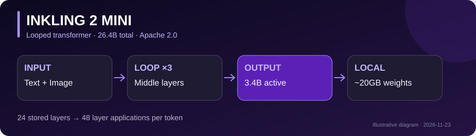
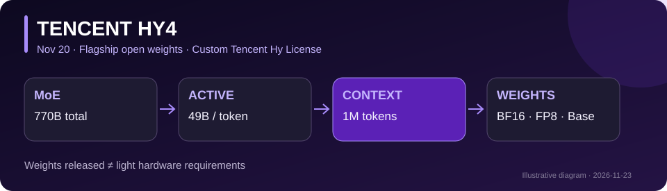
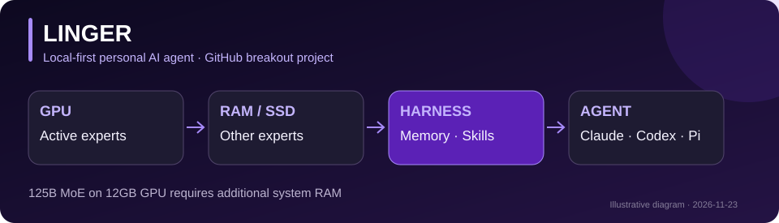
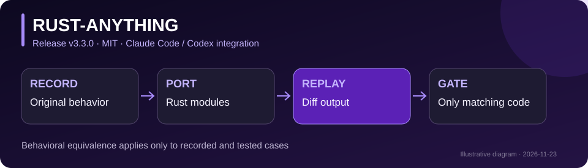
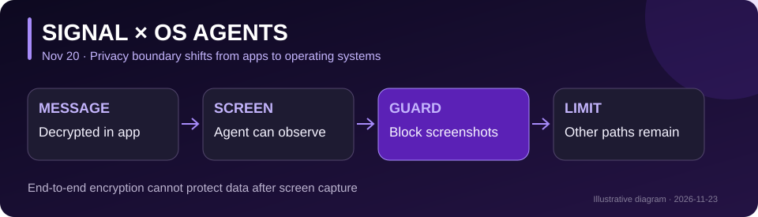

# AI·LLM·AI 에이전트·IT 산업 3일 브리핑

**발행:** 2026-11-23 08시 KST  
**조사 범위:** 2026-11-20 08시～2026-11-23 08시, Asia/Seoul  
**선정:** 새로운 오픈웨이트 모델 2건 · GitHub 오픈소스 화제 및 업데이트 2건 · AI Agent 프라이버시 이슈 1건  
**선정 기준:** 신규 공개 여부, 개발자 실무 활용성, 오픈소스 파급력, 산업·보안 영향, 공식 출처 검증

> **한 줄 결론:** 이번 3일은 ‘더 작은 모델에서 더 깊게 추론’, ‘거대 모델 가중치의 실제 공개’, ‘로컬 Agent와 검증 중심의 Coding Agent’, ‘OS 수준 Agent의 데이터 접근 통제’가 핵심이다.

**지난 회차와 중복 제외:** 11월 20일 브리핑에서 다룬 Gemini 4 Neon, Microsoft MAI Code 2·Flash, Vercel eve 1.0, Vercel Board 및 Palo Alto Networks의 Applied Compute 인수는 중대한 후속 업데이트가 확인되지 않아 다시 선정하지 않았다. Tencent Hy4는 11월 4일 API 출시 이후 **11월 20일 가중치가 실제 배포된 신규 단계**이므로 포함했다.

**이미지 주의:** 아래 그림 5개는 공식 화면이나 벤치마크 차트를 복제한 것이 아니라 주요 기술 구조를 설명하기 위해 별도로 만든 **개념도**다.

---

## 1. Thinking Machines, Inkling 2 Mini 공개 — 26.4B ‘루프형’ 오픈웨이트 모델

**발표일:** 2026-11-20 · **분야:** 신규 LLM · 오픈웨이트 · 로컬 AI · 추론 아키텍처

### 핵심 요약

Thinking Machines Lab이 **Inkling 2 Mini** 모델의 가중치와 연구용 가변 루프 모델을 공개했다. 모델은 **총 264억 파라미터**, 고유 활성 파라미터 **34억 개**의 희소 MoE이며, 24개 저장 레이어 중 **중간 12개 레이어를 각 토큰마다 3번 반복**한다. 반복 연산까지 고려한 효과적 활성 연산은 약 54억 파라미터에 해당한다.

- **컨텍스트:** 최대 100만 토큰. 텍스트·이미지 입력, 텍스트 출력.
- **정밀도·용량:** NVFP4와 MXFP8 혼합, 공식 체크포인트 약 20GB. Apple Silicon은 **통합 메모리 32GB 이상**을 권장한다.
- **개발사 자체 코딩 평가:** DeepSWE v1.1 **48.2%**, Vals Index v2.2 **46.5%**. 서로 다른 평가 세팅의 점수를 실서비스 성공률로 일반화하면 안 된다.
- **라이선스:** Apache 2.0. Hugging Face 가중치와 Tinker 추론·후학습 접근 제공.

### 왜 중요한가?

추론 성능 개선이 모델을 단순히 크게 만드는 데만 의존하지 않음을 보여준다. **같은 가중치 레이어를 반복 사용해 더 많은 내부 계산을 수행하는 구조**는 로컬 Agent의 성능·속도·비용 최적화에 새로운 선택지를 제공한다. 한편 내부 계산이 길어져 출력된 사고 과정만으로 모델을 감시하는 방식의 한계도 연구 주제로 남는다.

**신뢰할 수 있는 출처:** [Thinking Machines 공식 공개 · 11월 20일](https://thinkingmachines.ai/news/inkling-2-mini/) · [공식 모델 카드](https://thinkingmachines.ai/model-card/inkling-2-mini/) · [Hugging Face 가중치](https://huggingface.co/thinkingmachines/Inkling-2-Mini)

---

## 2. Tencent, Hy4 정식 가중치 공개 — 770B 멀티모달 MoE를 직접 운영하는 선택지

**가중치 공개일:** 2026-11-20 · **분야:** 오픈웨이트 LLM · 멀티모달 · 기업 AI 인프라

### 핵심 요약

11월 4일 API로 먼저 출시된 Tencent의 **Hy4 정식 모델**이 11월 20일 Hugging Face와 공식 저장소에서 다운로드 가능한 가중치로 공개됐다. **Hy4 instruct, Hy4-FP8, Hy4-base** 등 서로 다른 용도의 체크포인트가 제공된다.

| 항목 | 공식 저장소의 사양 |
|---|---|
| 언어 백본 | 770B 총 파라미터, 토큰당 49B 활성 |
| 비전 인코더 | 1.23B |
| DFly2 초안 모델 | 3.3B |
| 최대 컨텍스트 | 1,048,576 토큰 |
| 입력 | 텍스트·이미지·동영상 |
| 라이선스 | **Tencent Hy License 1.0** |

가중치가 공개됐어도 **Apache 2.0 라이선스가 아니다.** 라이선스에는 일정 매출·사용자 규모를 넘는 대형 Model-as-a-Service 사업자에 대한 추가 허락 요건이 있다. 또한 정밀도별 모델 파일은 수백 GB 이상이어서 개인용 GPU 한 장에서 간단히 실행하는 모델은 아니다.

### 왜 중요한가?

공개 API만 이용하던 기업이 대형 멀티모달 모델을 **전용 서버에서 직접 호스팅하고 튜닝할 가능성**이 커졌다. 다만 ‘오픈웨이트’가 곧 ‘제한 없는 상업 이용’이나 ‘저렴한 운영’을 의미하지 않는다. 도입 검토에서는 가중치 라이선스와 운영 하드웨어 비용을 동시에 확인해야 한다.

**신뢰할 수 있는 출처:** [Tencent 공식 GitHub](https://github.com/Tencent-Hunyuan/Hy4) · [Hugging Face 정식 가중치](https://huggingface.co/tencent/Hy4) · [라이선스 원문](https://huggingface.co/tencent/Hy4/blob/main/LICENSE)

---

## 3. GitHub 주목: Linger — Claude Code·Codex·Pi를 로컬 모델로 운용하는 개인 Agent

**최근 관심 확인:** 2026-11-21 오픈소스 뉴스 레이더 · **분야:** GitHub 화제 프로젝트 · 로컬 AI · 개인 Agent

### 핵심 요약

**simplexai-labs/linger**는 개인 PC에서 로컬 LLM을 실행하면서 메모리, 개인 위키, 도구 연결, 장기 실행 작업과 멀티 Agent 팀을 지원하는 프로젝트다. 단일 모델의 성능 향상보다 **로컬 추론 엔진과 Agent 하네스를 함께 최적화**하는 접근에 초점을 둔다.

- 자체 **PolyStrata** 실행 엔진은 자주 쓰이는 MoE expert를 GPU에, 나머지를 RAM 또는 SSD에 배치한다.
- 프로젝트는 **12GB GPU + 64GB RAM 환경에서 125B 모델 구동** 사례를 주장한다. 이는 GPU 메모리 12GB만으로 모델 전체를 적재한다는 뜻이 아니다.
- Claude Code, Codex, Pi와 같은 기존 하네스 연결, 백그라운드 작업, 개인 지식 메모리와 컴퓨터 조작을 지원한다.
- 11월 21일 신생 GitHub AI 프로젝트 목록에 등장해 관심을 얻었다. 성능 수치와 ‘Claude급’ 표현은 프로젝트 자체 주장에 가깝고 범용 작업에서 검증된 등급이 아니다.
- 라이선스는 **Linger Open Source License**, Apache 2.0 기반의 추가 조건이 있는 별도 라이선스다.

### 왜 중요한가?

Agent 시스템의 설계 중심이 ‘클라우드 모델 한 번 호출하기’에서 **개인 디바이스의 GPU·RAM 활용, 작업 스케줄링, 승인, 지식 유지, 여러 하네스 연결**로 확장된다. 로컬 환경에서 Code Agent를 병렬로 돌리거나 데이터 외부 전송을 줄이려는 개발자에게 참고할 만하다. 초기 버전인 만큼 업데이트·보안·설치 안정성은 직접 확인해야 한다.

**신뢰할 수 있는 출처:** [GitHub 공식 저장소](https://github.com/simplexai-labs/linger) · [GitHub Releases](https://github.com/simplexai-labs/linger/releases) · [11월 21일 신생 GitHub 프로젝트 집계](https://scouthub.dev/en/news/2026-11-21/)

---

## 4. GitHub 오픈소스 rust-anything v3.3 — AI의 Rust 마이그레이션을 Record·Replay로 검증

**업데이트:** 2026-11-22 v3.3.0 · **분야:** Coding Agent · MCP · 코드 재작성 검증 · MIT

### 핵심 요약

개발자 Erkam Yaman의 **rust-anything**이 11월 22일 **v3.3.0**을 출시했다. 기존 TypeScript·Python·Go·Java 등의 일부 기능을 Rust로 점진적으로 옮길 때 사용되는 CLI, MCP 서버 및 Coding Agent용 Skill이다.

1. **Record:** 기존 프로그램에 입력을 넣고 출력과 관측 가능한 동작을 기록한다.
2. **Port:** 사람이 직접 또는 Claude Code·Codex가 Rust 코드를 작성한다.
3. **Diff/Replay:** 원본 기록을 새 구현에 재현해 동작 차이를 비교한다.
4. **Gate:** 기록된 테스트가 일치하는 경우에만 포팅 단위를 통과시킨다.

v3.3.0은 Python에서 일부 함수만 포팅할 때 다른 클래스가 불필요하게 대체되는 문제, PHP 함수 단위의 Rust 브리지 등 호환성을 개선했다.

~~~bash
cargo install rust-anything
rust-anything setup
# 실제 마이그레이션은 격리된 테스트 저장소에서 시작
~~~

**중요한 한계:** 기록하지 않은 입력이나 부작용은 검증할 수 없으므로 **모든 프로그램에서 동작 동등성이 수학적으로 증명되는 도구는 아니다.** 코드 실행과 환경 설정 변경 권한도 확인해야 한다.

### 왜 중요한가?

Coding Agent가 코드를 생성하는 시간보다 **기존 코드와 동일하게 동작함을 입증하는 과정**이 중요해지고 있다. 기존 코드의 동작을 테스트 오라클로 만들고 새 구현을 자동 비교하는 패턴은 레거시 현대화, 성능 최적화, AI 코드 리뷰에 그대로 응용할 수 있다.

**신뢰할 수 있는 출처:** [GitHub 저장소 및 가이드](https://github.com/erkamyaman/rust-anything) · [공식 11월 22일 v3.3.0 릴리스](https://github.com/erkamyaman/rust-anything/releases/tag/v3.3.0) · [공식 변경 이력](https://github.com/erkamyaman/rust-anything/blob/main/CHANGELOG.md)

---

## 5. Signal, 모바일 OS AI Agent의 메시지 화면 읽기 차단 강화

**발표일:** 2026-11-20 · **분야:** AI Agent 보안 · 모바일 OS · 데이터 프라이버시

### 핵심 요약

메신저 **Signal**이 iOS 27과 지원되는 Android 환경에서 **운영체제에 통합된 AI 비서가 화면을 캡처해 Signal 대화 내용을 읽는 것을 제한**하는 정책을 발표했다.

- Signal은 기본적으로 화면 캡처를 차단하거나 AI의 화면 접근 시도를 탐지하는 보호 장치를 적용한다.
- 사용자는 설정에서 제한을 해제할 수 있으나, 대화 상대의 정보까지 다른 AI 시스템으로 전달될 위험이 발생할 수 있다.
- 기존 Windows Recall 대응과 같은 문제의식에서 출발했다.
- **보호 범위는 불완전하다.** 파일시스템이나 접근성 기능 등 다른 경로가 남을 수 있다.

이 문제는 암호 알고리즘이 깨졌다는 뜻이 아니다. **종단간 암호화로 전송된 메시지가 기기에서 복호화되어 화면에 표시된 이후** OS Agent가 그 정보를 추출할 수 있다는 점이 핵심이다.

### 왜 중요한가?

Computer Use Agent의 보급으로 보안 경계가 API 권한을 넘어 **스크린샷, 접근성 트리, 알림, 로컬 파일**까지 확장된다. 민감정보를 다루는 앱 개발자는 OS Agent가 무엇을 볼 수 있는지 점검하고, 업무용 Agent 운영자는 최소 권한, 사용자 동의, 화면 접근 제어와 유출 경로 감사를 설계해야 한다.

**신뢰할 수 있는 출처:** [Signal 공식 블로그 · 11월 20일](https://signal.org/blog/protecting-your-privacy/) · [Reuters 보도 · 11월 20일](https://www.reuters.com/legal/litigation/signal-restricts-screenshots-block-ai-agents-reading-messages-2026-11-20/) · [The Verge 보도](https://www.theverge.com/ai-artificial-intelligence/1038390/signal-blocking-ai-agent-screenshots-mobile-app)

---

## 이번 3일의 핵심 비교

| 뉴스 | 유형 | 개발·비즈니스 관점 |
|---|---|---|
| **Inkling 2 Mini** | 새로운 오픈웨이트 LLM | 더 적은 저장 가중치로 내부 반복 추론 |
| **Tencent Hy4 정식 가중치** | 모델의 중대한 후속 공개 | 자체 호스팅 가능성, 라이선스·GPU 비용 |
| **Linger** | GitHub 화제 프로젝트 | 로컬 모델과 기존 Coding Agent 하네스 결합 |
| **rust-anything v3.3** | GitHub 오픈소스 릴리스 | AI 코드 재작성 결과를 자동 비교 검증 |
| **Signal AI 차단** | AI Agent 보안·산업 이슈 | OS Agent의 앱 데이터 접근권 분리 |

### 이번 회차의 기술적 결론

AI 모델 자체의 발전과 동시에, 실제 현장에서 필요한 기능은 **로컬 실행 최적화, 하네스 연결, 자동 검증, 접근 권한 통제** 쪽으로 빠르게 확장되고 있다.

특히 **Linger와 rust-anything**을 비교하면 실무적인 교훈이 분명하다. Linger는 *Agent를 어떻게 지속적으로 운영할지*, rust-anything은 *Agent가 만든 변경을 어떻게 검증할지*에 집중한다. 여기에 Signal의 사례가 더해지면 앞으로의 Agent 아키텍처는 **실행·검증·권한**을 하나의 체계로 설계해야 한다.

---

### 출처·재현 및 보관 메모

- 전체 선정 항목의 신규 출시, 실제 가중치 공개, 주목 또는 중요 업데이트가 2026년 11월 20～22일 사이에 확인됐다. 초기 출시와 후속 공개 날짜는 구분했다.
- 기술적 성능·속도·품질 주장은 개발사 또는 프로젝트 발표에 근거하며, 독립 평가를 모두 거친 결과가 아니다.
- 설명용 SVG 5개는 본 Markdown과 같은 GitHub 경로의 `assets` 폴더에 저장된다.
- 이 문서는 서울 시간 **2026-11-23 08시** 회차로 장기 보관한다.
