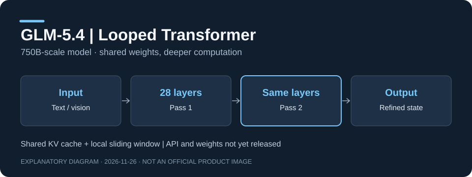
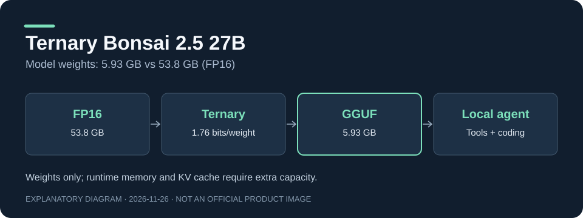
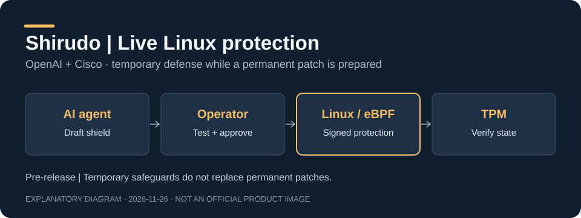
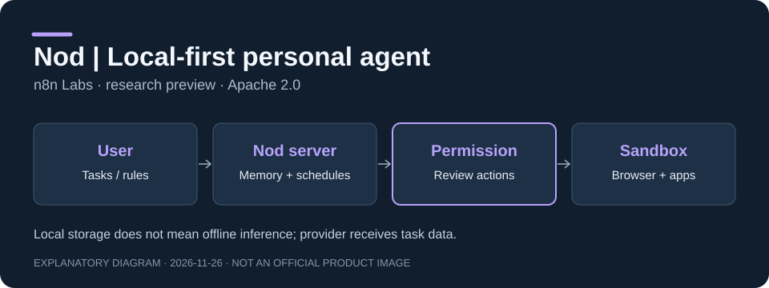
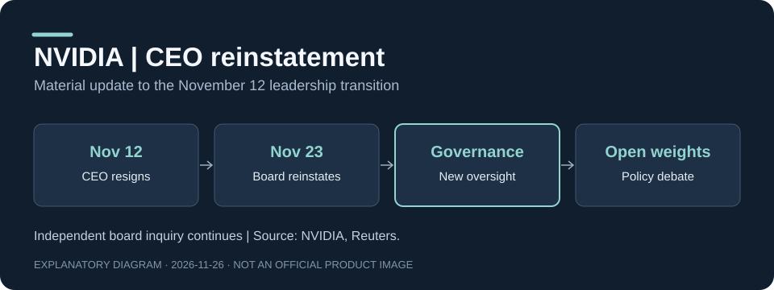

# AI·LLM·AI 에이전트·IT 산업 3일 브리핑

**발행 회차:** 2026-11-26 08시 KST  
**조사 기간:** 2026-11-23 08시～2026-11-26 08시 KST, 발행 직전 조사  
**선정:** 신규 LLM 2건 · 신규 오픈소스 보안 런타임 1건 · GitHub 화제 Agent 1건 · 테크 산업 1건

**핵심 흐름:** 가중치와 계산량의 분리, 저비트 로컬 추론, 운영환경에서의 안전한 Agent 실행, 오픈웨이트 생태계의 경영·정책 변화.

**중복 검토:** 직전 회차의 Inkling 2 Mini, Tencent Hy4, Linger, rust-anything, Signal은 반복하지 않았다. NVIDIA는 11월 14일의 사임 보도에 대한 중대한 후속 변화로 포함했다.

**이미지:** 아래 SVG는 공식 제품 화면이 아닌 독자 제작 설명용 개념도다.

---

## 1. Z.ai GLM-5.4 출시 — 750B 모델에 반복형 Transformer 적용

**발표일:** 2026-11-23 · **분야:** 신규 프런티어 LLM · 코딩 · 추론 아키텍처

### 핵심 요약

Z.ai가 7,500억 파라미터 규모의 GLM-5.4를 발표했다. 기존 GLM-5의 28개 레이어를 동일한 가중치로 두 번 실행하는 Loop Transformer 구조를 채택했다. 토큰별 업데이트 게이트와 KV 캐시 공유를 사용해 반복 계산에 따른 메모리 부담을 줄인다.

개발사는 2조～3조 파라미터 모델에 비견되는 능력을 주장하며 FreeCAD 로봇팔 모델링, 게임 및 영상 제작 사례를 공개했다. 해당 비교는 독립적으로 확인된 종합 벤치마크가 아니다. 과도하게 긴 추론도 남은 문제로 밝혔다.

GLM Coding Plan, ZCode, Z.ai Chat에서 이용 가능하다. API와 공개 가중치는 안전성 검토 이후 제공 예정이며 이번 조사 시점에는 공개되지 않았다.

### 왜 중요한가?

파라미터 수와 추론에 사용하는 계산량을 분리하는 설계가 소형 모델뿐 아니라 대형 프런티어 모델까지 확장되고 있다. 실제 도입 시에는 토큰 생성 속도만 아니라 작업당 총 지연시간과 비용을 평가할 필요가 있다.

**출처:** [Z.ai 공식 기술 발표 · 11월 23일](https://z.ai/blog/glm-5.4) · [PC Watch · 11월 24일](https://pc.watch.impress.co.jp/docs/news/2158757.html)

---

## 2. PrismML Bonsai 2.5 27B — 5.9GB 오픈웨이트로 코딩 Agent 성능 개선

**발표일:** 2026-11-24 · **분야:** 오픈웨이트 LLM · 로컬 AI · Apache 2.0

### 핵심 요약

PrismML이 Qwen3.8-27B 기반 Ternary Bonsai 2.5 27B를 공개했다. GGUF 가중치는 약 5.93GB로 FP16 원본 53.8GB의 약 9분의 1이며, 이전 버전과 유사한 저장 용량을 유지하면서 장시간 도구 사용과 코딩 능력을 개선했다.

| 개발사 자체 평가 | Bonsai 2 | Bonsai 2.5 | FP16 원본 |
|---|---:|---:|---:|
| SWE-bench Verified | 60.8% | 75.6% | 80.6% |
| Terminal-Bench 2.1 | 52.8% | 60.1% | 70.8% |
| DeepSWE v1.1 | 0% | 27.0% | 30.1% |

llama.cpp 및 Apple MLX 실행용 파일이 공개됐다. 수치는 개발사 측정이며 5.93GB는 가중치 파일 크기이지 전체 VRAM 요구량이 아니다. 컨텍스트와 KV 캐시, 런타임 메모리를 별도로 고려해야 한다.

### 왜 중요한가?

개인용 GPU에서 로컬 Coding Agent를 실험할 수 있는 범위가 넓어진다. 특히 개인정보나 사내 소스코드를 외부로 보내지 않는 구조에 유용하지만, 실제 업무의 성공률과 속도는 직접 검증해야 한다.

**출처:** [PrismML 공식 발표 · 11월 24일](https://prismml.com/news/bonsai-2-5-27b) · [Hugging Face 공식 GGUF](https://huggingface.co/prism-ml/Ternary-Bonsai-2.5-27B-GGUF) · [PC Watch · 11월 25일](https://pc.watch.impress.co.jp/docs/news/2159034.html)

---

## 3. OpenAI·Cisco Shirudo 공개 — 재시작 없이 Linux 취약점 임시 방어

**발표일:** 2026-11-23 · **분야:** GitHub 오픈소스 · Linux · DevSecOps

### 핵심 요약

OpenAI와 Cisco가 Linux용 보안 런타임 Shirudo를 공개했다. eBPF를 이용해 서비스가 계속 실행되는 동안 취약한 동작만 제한하는 임시 보호 규칙을 적용하는 프로젝트다.

AI Agent가 방어 규칙을 제안하고, 운영자가 테스트와 승인을 거쳐 배포한다. 서명 검증과 TPM 기반 상태 증명을 지원한다. 개발사 통제 실험에서는 Codex가 만든 규칙으로 실행 중인 Elasticsearch 서비스의 공격 시도를 차단하면서 서비스를 유지했다고 밝혔다.

GitHub 저장소는 프리릴리스 상태이며 실제 운영에는 전용 커널 패치와 TPM 2.0 등 요구 조건이 있다. BSD 2-Clause 라이선스이며 BPF 프로그램은 BSD/GPL 이중 라이선스다. 임시 방어는 정식 보안 패치의 대체물이 아니다.

### 왜 중요한가?

취약점 발견과 실제 패치 배포 사이의 시간차가 운영 리스크다. 이를 줄이기 위한 AI 보안 자동화가 코드 분석을 넘어 운영체제 실행 계층까지 확장되고 있다. 안전하게 적용하려면 정상 트래픽 검증, 승인, 롤백과 변경 기록이 필요하다.

**출처:** [OpenAI 공식 발표 · 11월 23일](https://openai.com/index/introducing-shirudo/) · [Shirudo 공식 GitHub](https://github.com/shirudo-dev/shirudo)

---

## 4. GitHub 주목: n8n Labs Nod — 개인 PC에서 지속적으로 일하는 Agent

**최초 공개:** 2026-11-10 · **최근 주목:** 2026-11-25 GitHub 주간 Trending 4위로 집계 · **분야:** 개인 Agent · 오픈소스

### 핵심 요약

n8n Labs의 Nod는 기존 n8n 워크플로 제품과 별개인 개인용 Agent다. 로컬 컴퓨터나 자체 서버에서 실행하며 이메일, 일정, 웹사이트, Slack 등의 작업을 처리한다. 사용자가 선택한 모델을 연결하고 브라우저 격리, 장기 메모리, 예약 실행과 외부 변경 승인 절차를 제공한다.

11월 25일 Trend.ondo의 GitHub 주간 목록 집계에서 4위로 나타났으며 공식 저장소는 조회 시 약 3,500 stars였다. 새 출시가 아니라 최근 관심이 확인된 프로젝트로 선정했다. 개발사는 678회의 모의 업무 평가에서 허가 범위를 벗어난 행동이 없었다고 보고했지만, 실제 환경의 안전을 보장하지 않는다.

로컬 저장과 로컬 추론은 다르다. 외부 모델을 사용하면 작업에 필요한 데이터가 모델 제공사로 전송될 수 있고, 컴퓨터가 절전 상태에 들어가면 예약 실행은 멈춘다. 현재 연구 프리뷰다.

### 왜 중요한가?

자동화의 입력이 고정된 워크플로에서 개인별 자연어 지시, 메모리, 장기 실행으로 확장되고 있다. Agent 제품을 직접 개발할 때 모델 선택, 실행환경, 승인 정책, 비용 상한을 분리하는 사례로 참고할 만하다.

**출처:** [n8n 공식 발표 · 11월 10일](https://blog.n8n.io/meet-nod/) · [공식 GitHub](https://github.com/n8n-io/nod) · [공식 제품 문서](https://nod.n8n.io/) · [GitHub 트렌드 집계 · 11월 25일 조회](https://trend.ondo.sh/github/en.html) — 마지막 링크는 일별로 갱신되는 페이지다.

---

## 5. NVIDIA 젠슨 황 CEO 복귀 — 오픈웨이트 AI 정책 논쟁 재부상

**발표일:** 2026-11-23 · **후속 보도:** 2026-11-24 · **분야:** AI 반도체 · 기업 경영 · 산업 정책

### 핵심 요약

NVIDIA 이사회가 11월 12일 사임한 젠슨 황을 CEO, 사장 및 이사로 복귀시키기로 만장일치로 결정했다. 임시 CEO였던 Colette Kress는 CFO 직책을 유지한다.

회사는 독립 이사들의 조사도 계속 진행한다고 밝혔다. 국가안보 및 수출통제위원회를 설치했고 최고준법책임자 채용을 추진한다.

11월 24일 Reuters는 황의 복귀로 미국 내 오픈웨이트 AI 지원 정책을 둘러싼 논쟁이 다시 부각됐다고 보도했다. 접근성과 비용 절감을 강조하는 입장과 고성능 공개 모델의 악용 위험을 강조하는 입장이 공존한다. 이전 11월 14일 브리핑의 사임 보도에 대한 중대한 후속 변화로 포함했다.

### 왜 중요한가?

AI GPU 공급망의 핵심 기업의 경영 연속성이 회복된다는 의미가 있다. 동시에 오픈웨이트 정책과 반도체 수출통제, 기업 거버넌스가 AI 인프라 투자에 영향을 줄 수 있다. 이번 복귀가 공급 정책이나 GPU 가격의 변화를 곧바로 확정하는 것은 아니다.

**출처:** [NVIDIA 공식 투자자 발표 · 11월 23일](https://investor.nvidia.com/news/press-release-details/2026/NVIDIA-Board-Reinstates-Jensen-Huang-as-President-CEO-and-Board-Director/default.aspx) · [Reuters · 11월 24일](https://www.reuters.com/world/china/huangs-return-nvidia-brings-open-weight-ai-debate-forefront-washington-2026-11-24/)

---

## 이번 회차 핵심 정리

| 소식 | 개발·비즈니스 관점 |
|---|---|
| GLM-5.4 | 가중치 공유로 추론 깊이 확장 |
| Bonsai 2.5 27B | 저비트 로컬 Coding Agent |
| Shirudo | 서비스 중단을 줄이는 AI 보안 방어 |
| Nod | 개인용 Agent의 로컬 실행·승인·메모리 |
| NVIDIA CEO 복귀 | AI GPU 공급망 경영과 오픈웨이트 정책 |

**실무 우선 검토:** Bonsai는 로컬 추론 실험, Shirudo는 DevSecOps 기술 검토에 적합하다. 전자는 실제 VRAM과 작업 성공률을 측정하고 후자는 격리 VM에서 시작할 필요가 있다.

벤치마크와 제품 평가 수치는 개발사 발표 조건에 한정된다. 발표일, 가중치 공개 여부, 프리뷰와 정식 제공을 구별했다.
